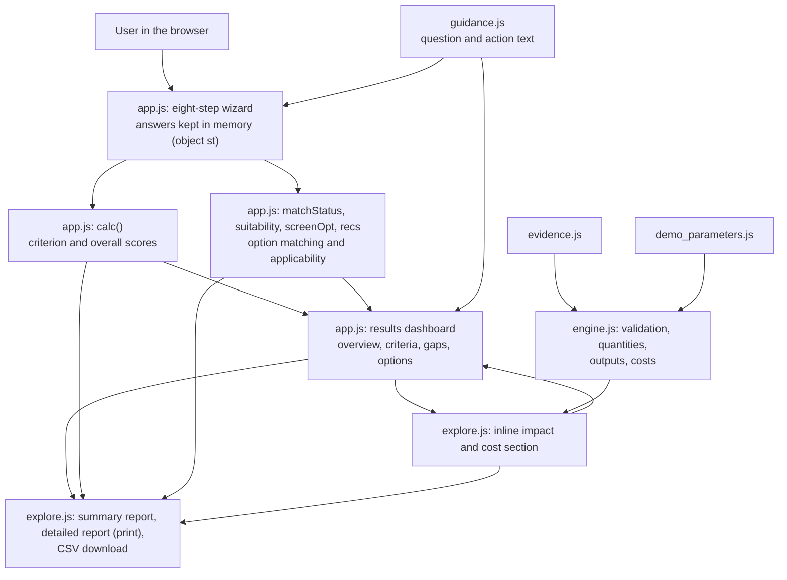
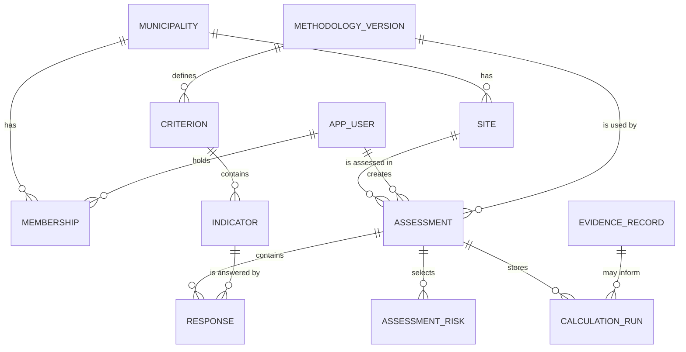

# NBS4MED Self-Evaluation Tool: Technical Documentation

This guide explains how the current prototype is built, so that a researcher or developer can run it, understand it, change it safely and plan its next stage. For a short introduction to the project, read [`README.md`](README.md) first.

**How to read this document.** Everything in sections 1–8 describes the application *as it exists today* and was checked against the source files. Section 9 is a *proposal* for future work. **No backend, API, SQL database, user accounts or central storage of assessments exists in the current application.** Items that need confirmation by the project team are marked **(to be confirmed)**.

**Contents:** [1 Technology stack](#1-technology-stack) · [2 Project structure](#2-project-structure) · [3 System architecture](#3-system-architecture) · [4 Assessment and scoring logic](#4-assessment-and-scoring-logic) · [5 Evidence and parameters](#5-evidence-and-parameters) · [6 Impact and cost calculations](#6-impact-and-cost-calculations) · [7 Local setup and maintenance](#7-local-setup-and-maintenance) · [8 Current technical limitations](#8-current-technical-limitations) · [9 Proposed development roadmap](#9-proposed-development-roadmap)

---

## 1. Technology stack

The application is a **static front end**: a set of files that a web browser opens and runs by itself. There is no server-side code.

| Technology | Where it is used | Purpose |
|---|---|---|
| **HTML5** | `index.html` | Page structure for the introduction, the assessment wizard, and the results page. |
| **CSS** (inline `<style>` in `index.html`) | `index.html` | All styling, including right-to-left (RTL) Arabic layout, responsive breakpoints (for example 700 px and 1000 px), reduced-motion support and print styles (`@media print`). |
| **JavaScript** (plain browser JavaScript, ES5 style: `var`, functions, no modules, no framework) | `app.js`, `explore.js`, `engine.js`, `guidance.js` | Assessment logic, scoring, recommendations, calculators, rendering, reports. Each file is wrapped in an immediately-invoked function and exposes a small global object (see section 3). |
| **JSON** | `evidence.json`, `demo_parameters.json` | The editable source data: an evidence register and the demonstration parameters. |
| **JavaScript data files** | `evidence.js`, `demo_parameters.js` | Copies of the two JSON files written as `window.NBS4MED_EVIDENCE = {...};` and `window.NBS4MED_PARAMS = {...};`. This lets the page work when opened directly from disk, because browsers block `fetch` of local files. Both copies were checked and hold the same data as their JSON files. |
| **Inline SVG** | `index.html` (icons), `app.js`, `explore.js` (charts and range bars) | Icons and charts. The charts work offline and print cleanly. |
| **Google Fonts** (Source Sans 3, Source Serif 4, IBM Plex Sans Arabic) | `<link>` in `index.html` | Typography. This is the only external resource the page requests. Without internet the page falls back to system fonts. |
| **Browser print function** (`window.print()`) and **Blob download** | `explore.js` | The summary and detailed reports are printed (or saved as PDF) through the browser's print dialog; the CSV file is built in memory and downloaded. |
| **Markdown** | `*.md` files | Documentation. |
| **Windows batch** | `run-demo.bat` | Convenience launcher: starts `py -m http.server` or `python -m http.server` on port 8765. |
| **GitHub Pages** | repository settings | Hosting. The Actions history shows the automatic `pages-build-deployment` workflow running for the `main` branch. The exact Pages source setting (branch and folder) is not visible in the repository files **(to be confirmed in Settings → Pages)**. |
| **Node.js + Playwright (Chromium)** | `qa-tests/` | Optional browser tests (section 7). Not required to run the application. |

There is **no** `package.json`, build step, bundler, transpiler, package manager dependency, backend or database in the repository.

---

## 2. Project structure

All application files are in the repository root (a deliberate "flat" layout so files can be uploaded through the GitHub web page).

### Application files

| File | Size (lines) | Responsibility | Depends on / used by |
|---|---|---|---|
| `index.html` | ~975 | Page markup, all CSS, the introduction page, the footer with funding acknowledgement, and the `<script>` tags that load everything else. | Loads the scripts below in a fixed order. |
| `app.js` | ~1,420 | The core application: constants for criteria, indicators, pilots, risks and the nine NbS options; text strings in English and Arabic; the eight-step wizard; scoring (`calc`); matching (`suitability`, `recs`); applicability checks (`screenOpt`); gap items; the results page; routing by URL hash; event handling. Publishes `window.NBS4MED_CORE`. | Reads `NBS4MED_GUIDE` and `NBS4MED_EXPLORE`. |
| `explore.js` | ~1,170 | Presentation layer for the inline impact and cost section, and the reports: picker and inputs, result tables, evidence blocks, cost range bars, the two-page summary report, the detailed report and the CSV export. Publishes `window.NBS4MED_EXPLORE`. | Calls `NBS4MED_ENGINE` for every number and `NBS4MED_CORE` for assessment state. |
| `engine.js` | ~300 | The calculation engine. No access to the page (no DOM). Input validation, design quantities, physical outputs, cost builder, green-roof reference cost scaling. Publishes `window.NBS4MED_ENGINE`. | Reads `NBS4MED_EVIDENCE` and `NBS4MED_PARAMS`. |
| `guidance.js` | ~160 | Per-indicator wording in English and Arabic: the question, the "Read more" explanation (what, why, what to consider), the suggested action for an answer of 0 or 1, and the "evidence needed" text. Publishes `window.NBS4MED_GUIDE`. | Used by `app.js` for the question cards and the gaps section. |
| `evidence.json` / `evidence.js` | ~1,120 | Evidence register (see section 5). | Read by `engine.js` and `explore.js`. |
| `demo_parameters.json` / `demo_parameters.js` | ~1,790 | Demonstration parameters, calculator input definitions and cost components (see section 5). | Read by `engine.js` and `explore.js`. |
| `assets/nbs4med-interreg-eu-logo.png` | | Composite Interreg NEXT MED / EU / NBS4MED logo used in the footer. | `index.html` |
| `run-demo.bat` | | Windows local launcher. | |
| `.gitignore` | | Ignores `*.log`, `.DS_Store`, `Thumbs.db`. | |

### Documentation, tests and evidence

| Path | Contents |
|---|---|
| `README.md` | Short project introduction. |
| `TECHNICAL_DOCUMENTATION.md` | This file. |
| `CALCULATIONS.md` | Formulas, assumptions and the full parameter table. Not duplicated here. |
| `GAP_ACTION_LOGIC.md` | How indicator answers map to gaps and improvement actions, with methodological observations. |
| `BRANDING_ASSETS.md`, `REDESIGN_REPORT.md`, `FINAL_QA_REPORT.md`, `DEMO_VIDEO_PACKAGE.md` | Branding notes, redesign record, QA report with test matrix, and the İzmir demonstration scenario. |
| `qa-tests/` | Thirteen Node.js scripts that drive the application in a headless browser (section 7). |
| `qa-evidence/`, `redesign-evidence/`, `branding-evidence/`, `header-logo-evidence/` | Screenshots, sample PDFs and CSV files produced during QA. They are records, not part of the running application. |

### Load order and how files interact

`index.html` loads the scripts in this order (the order matters, because later files read the globals created by earlier ones):

1. `evidence.js` → creates `NBS4MED_EVIDENCE`
2. `demo_parameters.js` → creates `NBS4MED_PARAMS`
3. `engine.js` → creates `NBS4MED_ENGINE`
4. an inline script calls `NBS4MED_ENGINE.init(NBS4MED_EVIDENCE, NBS4MED_PARAMS)`
5. `explore.js` → creates `NBS4MED_EXPLORE` (it looks up `NBS4MED_CORE` only when it renders, so it can load before `app.js`)
6. `guidance.js` → creates `NBS4MED_GUIDE`
7. `app.js` → creates `NBS4MED_CORE` and starts the application

---

## 3. System architecture

### Flow from input to output



Everything runs inside the visitor's browser. There is no network request for assessment data (the code contains no `fetch`, XMLHttpRequest, form submission or `sendBeacon`), and nothing is written to `localStorage`, `sessionStorage` or cookies.

### Step by step

1. **User input.** The user moves through eight steps (`STEPS` in `app.js`): area and scale, site context, local climate risks, then one step per criterion C1–C5. Every answer is stored in one in-memory object (`st`). Closing or reloading the page discards it. A "Fill with sample data" action and a "Clear all" action exist in the assessment sidebar.
2. **Validation.** `stepMissing` blocks "Next" until a step is complete. `indOk` accepts an indicator when it has a score, "Unknown", or "Not applicable" with a justification.
3. **Scoring.** `calc()` computes per-criterion and overall points, percentages and status (section 4).
4. **Recommendations.** `recs()` computes the option match scores from the selected risks and site context, then merges the optional applicability screening (section 4).
5. **Results.** The results page (`#results`) is available when all 19 questions are complete (`TOTAL_Q = 2 + 2 + 1 + 14`). It combines scores, gaps (`gapItems`), options and the inline impact and cost section.
6. **Impact and cost.** `explore.js` collects the inputs and calls `NBS4MED_ENGINE.calculate(solutionId, inputs, touched, prices)`. The engine returns a result object with outputs, costs, warnings and a list of things that are deliberately not calculated (section 6).
7. **Exports.** `explore.js` builds the summary report (two A4 pages), the detailed report and the CSV from the same state and calls `window.print()` or downloads a Blob.

### Navigation (URL hash)

Navigation works from the in-memory state; the hash is a convenience. `route()` in `app.js` handles `#assessment`, `#results` (falls back to the assessment if it is incomplete), `#explore` (opens the inline impact and cost section of the results page), and `#about`, `#how`, `#resources` (sections of the introduction). Any other hash shows the introduction.

### Language and layout

`lang` is `'en'` or `'ar'`. Every user-facing string is stored as an English and Arabic pair. Switching to Arabic sets right-to-left direction and the Arabic font. Evidence records and some source titles are shown in English only, as in the source database.

---

## 4. Assessment and scoring logic

All of the logic in this section is in `app.js`, with wording in `guidance.js`.

### Criteria, indicators and answers

Five criteria (`CRIT`) and 14 indicators (`IND`): C1 has 3 (1.1–1.3), C2 has 3 (2.1–2.3), C3 has 3 (3.1–3.3), C4 has 2 (4.1–4.2), C5 has 3 (5.1–5.3). The names are listed in the [README](README.md#3-assessment-framework). Each indicator has three rubric statements (for scores 0, 1 and 2). The code comment states that the rubric is a **provisional project rubric for partner review** against the PROMEA framework and the NBS repository.

Each indicator takes exactly one primary answer:

| Answer | Stored as | Effect |
|---|---|---|
| 0, 1 or 2 | number | Counted in the points and in the maximum (2 points per scored indicator). |
| Unknown | `'U'` | Missing information. Not zero. Blocks the percentage of its criterion and the overall percentage. |
| Not applicable | `'NA'` | Requires a written justification. Counted in neither points nor maximum. |
| Unanswered | none | Treated as an open item. Blocks results until answered. |

Optional extras per indicator (rationale, evidence description, confidence High / Medium / Low) are stored and reported, and the confidence is summarised separately from completeness. They do not change any score.

### Scores

`calc()` produces, for each criterion, `sum`, `scored`, `max = scored × 2`, and `pct = round(sum / max × 100)` only when no indicator of the criterion is Unknown or unanswered. The overall result is computed the same way over all indicators and is shown only when nothing is open. The level uses provisional thresholds (`lvlIdx`): below 30% *Insufficient*; 30–54% *Partial*; 55–79% *Adequate*; 80% and above *Strong*. These are project design choices. `GAP_ACTION_LOGIC.md` lists known methodological observations, for example that all indicators weigh equally (so C4, with two indicators, counts less in total), and that a criterion with a single Unknown shows no percentage at all.

### Gaps and improvement actions

`gapItems()` reads only the indicator answers: 0 is listed as *Gap*, 1 as *Partial*, Unknown as *To verify*; 2 and Not applicable are not listed. The finding is the rubric text the user selected, the suggested action comes from `guidance.js` (`act[0]`, `act[1]`), and "Why it matters" and "Evidence needed" are fixed per indicator. Items are ordered by score tier (0, then 1, then Unknown), then by indicator order. This is a transparent display order, not a validated priority ranking. Details: [`GAP_ACTION_LOGIC.md`](GAP_ACTION_LOGIC.md).

### Three separate things

| What | Computed from | Where | What it is not |
|---|---|---|---|
| **Assessment score** | The 14 indicator answers | `calc()` | Not used for matching, applicability, impact or cost. Not a validated measure of NBS integration. |
| **Matching score** | Selected risks and site context only | `suitability()`, `recs()` | Not a probability of success, a feasibility assessment or a predicted impact. Assessment scores are not used. |
| **Applicability status** | Optional yes/no/unknown checks the user answers on the results page | `screenOpt()` | Screening only, not engineering approval. |

### Recommendation matching

- Nine options (`OPT`): urban forest (Miyawaki method), green roof, green corridor, rain garden and bioswale, permeable paving, pocket park, smart eco-park, rainwater retention basin, vegetated dune and shoreline.
- Each option has a provisional weight from 0 to 3 for each of heatwaves, flooding and drought, a land-need level and a technical-complexity label.
- `rawMatch` adds the weights of the selected risks. `suitability` computes `raw / (number of selected risks × 3) × 100`, subtracts 15 points for each level by which the option's land need exceeds the available public land (Limited = 0, Moderate = 1, Abundant = 2), subtracts 10 more if urban density is High and the option's land need is the highest level, and limits the result to 0–100.
- `matchStatus()` blocks matching altogether, with an explanatory message, when "Not sure" is chosen, no risk is selected, a selected risk has no rules (coastal storms or land degradation), urban density or public land is missing, or public land is Unknown.
- Options with a final score of 0 appear under "Other options", never described as technically unsuitable. Options marked not applicable by screening are listed separately. The top three ranked options are shown as cards.
- The funding, maintenance and technical-capacity answers (5.1, 5.2, 3.2) appear next to the recommendations as "shared implementation conditions". They do not change any score.
- The weights, land adjustments and complexity labels are provisional demonstration rules without PROMEA validation.

### Applicability checks

Each option has a short list of yes/no/unknown questions (`CHK`, `RULE`, `DEP`), for example roof availability and structure for the green roof, or catchment and space for the retention basin. A dependent question is hidden when a prerequisite is answered No. Statuses (`screenOpt`):

| Status | Meaning |
|---|---|
| Not yet checked | No relevant question answered. |
| Requires verification | A check is incomplete, answered Unknown, or a condition that can still be assessed or designed is answered No. |
| Preliminary candidate | Every shown check is answered Yes. |
| Not applicable | An essential prerequisite is answered No, or the roof is assessed as structurally unsuitable. |

The green-roof structural check has three states: *Confirmed suitable*, *Assessment pending or Unknown* (which never means unsuitable), and *Assessed and unsuitable*. Answers are kept per question for the session only.

### Other behaviour worth knowing

- **Assessment area:** one of five pilot areas (Cerdanyola del Vallès, İzmir, Sikionies, a Tunisian retention-basin pilot, Heliopolis University) or "other" with free-text name, country and city. Choosing a pilot sets the scale to "Site / Project Area" automatically unless the user already picked one.
- **Feedback form:** a partner feedback form is implemented in `app.js` (`fbHtml`) but is not shown in the interface, and its message says feedback is not transmitted.
- **Alignment with the draft framework** (from the earlier README; not a claim of full coverage or formal validation):

| Element | Status in this prototype |
|---|---|
| Five criteria and 14 indicators (provisional rubric) | Existing |
| Applicability checks for each of the nine options | Existing (optional, after the results) |
| Climate risks (five risks plus a separate "Not sure" option, multi-select) | Partial: no primary-risk selector |
| Solution categories | Partial: provisional display labels on the nine options; they do not affect matching, scoring or calculators |
| Impact and cost exploration | Partial: five of the nine options have a calculator |
| NGO involvement | Partial: named in indicator 4.2 |
| Climate type | Not implemented |
| Primary-risk selector, readiness questionnaire beyond the 14 indicators, monitoring forms, budget inputs and comparison | Missing |

---

## 5. Evidence and parameters

### Evidence register (`evidence.json`, mirrored in `evidence.js`)

- **Origin:** exported from a spreadsheet named `NBS4MED_Starter_Database (2).xlsx`, version "v2 (2026-10-11)". The spreadsheet is **not** in this repository.
- **Status as written in the file:** "Starter evidence register for NBS4MED meeting review. Not an approved project repository."
- **Contents:** 5 solutions, 22 evidence records, 8 sources, 10 rules (R01–R10), 5 methods (M01–M05), a readiness table per solution and a change log. Each evidence record states its outcome variable, statistic type, units, context, study group, extraction status, allowed use and what is missing for transfer to another site. Sources include Climate-ADAPT pages, a Hamburg green-roof economic evaluation, and published studies on green-roof retention and on cooling by green spaces.
- **Forecast policy:** every record has `usable_for_local_forecast = false`. Records are shown as reference evidence, or used only in clearly labelled scenarios.
- **Rules:** R01–R10 describe how evidence may be used (for example no pooling of different outcomes, a missing value is never zero, no feasibility claim while structural capacity is unknown). R07 (very low match score) is marked "Proposed rule; not implemented". `CALCULATIONS.md` states how the others are applied; Each rule has not been re-verified line by line in the code for this document.
- **Independence:** the interface counts independent studies (`study_group`), not records, because several records come from one study.
- **Methods not implemented:** price-year update (M02) and life-cycle cost (M05) are listed but not implemented, because no price index or discount rate has been supplied.

### Demonstration parameters (`demo_parameters.json`, mirrored in `demo_parameters.js`)

- Version "demo-0.1", dated 2026-10-11. Status as written: "Demonstration assumptions. Not project data. Not validated by partners."
- **43 parameters**, all with `source_class = demo_assumption`, and the `partner_validated` field empty for all of them. Each has an id, solution, unit, value (low / base / high), purpose, scope and a valid range.
- **3 published reference parameters** (green-roof event retention for events above 10 mm, typical retention below 10 mm, and reference construction costs), which point to evidence records G01, G02 and the seven extensive-roof cases H1, H2, H4 and H6–H9.
- **Calculator definitions** per solution (`solutions.NBS01` … `NBS05`): input fields with defaults, minimum, maximum and whether required, and cost components.
- **Currency and price year:** EUR, with no price year. The demo values were not taken from a dated price list.
- **Exclusions stated in the file:** land acquisition, VAT unless stated, utility relocation, contingency, financing and replacement beyond annual maintenance.

### How the data is loaded and used

The `.js` copies are loaded as scripts, then `NBS4MED_ENGINE.init` indexes the records and parameters by id. `engine.js` uses them for calculations; `explore.js` uses them to display evidence cards, sources, formulas, parameter provenance and warnings.

### Known assumptions and validation limits

- Nothing has been validated by project partners. No evidence record may be read as a local forecast.
- All unit prices, water-demand rates, runoff coefficients and usable-storage fractions are demonstration assumptions.
- Low and high are alternative demo assumptions ("illustrative scenario range"), not confidence intervals.
- Source titles and evidence records are in English only.

---

## 6. Impact and cost calculations

The formulas, parameter table and "what to replace" list are in [`CALCULATIONS.md`](CALCULATIONS.md) and are not repeated here. This section explains the workflow in the code.

### Workflow (`engine.js`)

1. **Resolve inputs** (`resolveInputs`): applies defaults, converts commas to decimal points, and rejects missing required, invalid, zero, negative or out-of-range values. A missing value is reported as missing, never treated as zero.
2. **Cross-field checks:** for the eco-park, the four area shares must add up to 100%.
3. **Design quantities** (`QTY`): for example plants, substrate volume, excavation volume, tree count. These are quantities to build or buy, not impacts.
4. **Validity warnings:** a warning appears when the main input is outside the range for which the demo parameters were set, or when the storm depth is the default.
5. **Outputs** per solution: physical or resource calculations, plus literature-based reference evidence where it exists. Outcomes that cannot be calculated are listed in `not_calculated` with reasons (for example air temperature, surface temperature, annual retention, peak reduction, flood-risk reduction).
6. **Costs** (`buildCosts`): capital cost = Σ(quantity × unit price) and annual cost = Σ(quantity × annual unit cost), each as low / base / high. The user may override unit prices. Rows are labelled as demo assumption or user entered. Capital and annual costs are never added together.
7. **Green-roof reference cost** (`roofReference`): scales seven published Hamburg case costs per m² by the roof area, only inside the area range of those cases.

### Three kinds of numbers, kept apart

| Kind | Examples | How it is labelled |
|---|---|---|
| **Physical calculation** (arithmetic on the user's inputs) | Rain falling on a roof, substrate volume, basin storage capacity, one-event runoff volume | "Arithmetic on your inputs" or "demo assumption" where a demo coefficient is used |
| **Published evidence** | Green-roof event retention of 26.8–61.8% (applied only to events above 10 mm), Hamburg reference costs | "Published reference". Literature-based, from other places, not a forecast for the user's site. No central estimate is shown. |
| **Illustrative cost** | Capital and annual cost ranges | "Illustrative scenario cost, not a local price estimate", with currency, no price year and scope stated |

The interface states that quantitative local climate-risk mitigation impact is not currently estimated.

### Presentation (`explore.js`)

`explore.js` keeps one set of inputs per option, so switching options does not lose entries. It renders result groups, a formulas table, evidence blocks, cost range bars (each cost on its own scale), warnings and assessment-based conditions. The calculators use only the option selected by the user; they do not use assessment scores.

---

## 7. Local setup and maintenance

### Run locally

No installation or build step is needed.

- **Open the file:** double-click `index.html`. This works because the data is loaded as scripts, not with `fetch`.
- **Serve the folder** (verified method used in the QA records):
  ```bash
  python3 -m http.server 8765
  # open http://localhost:8765/index.html  (add #assessment to go straight to the assessment)
  ```
- **Windows:** double-click `run-demo.bat`.

### Updating evidence or parameters

1. Edit the `.json` file (`evidence.json` or `demo_parameters.json`). Keep valid JSON.
2. Regenerate the matching `.js` file so it contains the same data. The file headers mention a script `tools\sync-data.ps1`, which **is not present in this repository**. As a replacement, this Node.js snippet reproduces the existing files exactly, apart from line-ending characters (checked by comparing the output with the current files):
   ```bash
   node -e "
   const fs=require('fs');
   for (const [j,o,g] of [['evidence.json','evidence.js','NBS4MED_EVIDENCE'],['demo_parameters.json','demo_parameters.js','NBS4MED_PARAMS']]) {
     const data=JSON.parse(fs.readFileSync(j,'utf8'));
     fs.writeFileSync(o,'/* Generated from '+j+'. Edit the .json, then run tools\\\\sync-data.ps1. */\n'+'window.'+g+' = '+JSON.stringify(data,null,2)+';\n');
   }"
   ```
   Replace the header comment as appropriate if you adopt a different sync tool.
3. Reload the page. The interface does not need to change when record or parameter values change, but a new solution, input type or output type does need changes in `engine.js` and `explore.js`.
4. If you change a value that `CALCULATIONS.md` quotes, update `CALCULATIONS.md` too (it is the single place for formulas and parameter documentation).

### Changing assessment content

- Indicator text, rubrics, pilot list, risks and option weights are constants at the top of `app.js`; question wording and action text are in `guidance.js`. Each text exists in English and Arabic; keep both in step.
- Changing scoring, thresholds or matching weights is a **methodology change**: agree it with the partners and document it (see `GAP_ACTION_LOGIC.md` and section 4).

### Testing

- **Syntax check** (no dependencies): `node --check app.js` (and likewise for `explore.js`, `engine.js`, `guidance.js`). All four pass on the current files.
- **Browser tests:** `qa-tests/` contains Node.js scripts that drive the page with Playwright and Chromium. They are **not turnkey**: there is no `package.json`; the scripts load Playwright and a Chromium binary from fixed paths (`/opt/node-tools/...`, `/opt/pw-browsers/...`); and some refer to reference copies of the code in a scratchpad directory. Adjust those paths before reuse. Typical use: `node qa-tests/qa1.js <url-or-file-url>`.
- **Recorded results:** `FINAL_QA_REPORT.md` records results as of 2026-10-17 for an earlier build (for example 190 checks in the eight-stage flow and 864 in an independent calculator verification), and later pull request descriptions list further suites. These records were not re-run for this document.
- **Manual checks worth repeating after a change:** Arabic right-to-left layout, mobile width (about 390 px), both print reports (two A4 pages for the summary), the CSV file, and the İzmir scenario in `DEMO_VIDEO_PACKAGE.md`.

### Repository maintenance

- The website is published from the `main` branch **(Pages source to be confirmed in Settings → Pages)**. Merging to that branch changes the live site, so prefer pull requests and review.
- Keep the two `.js` data files in step with their `.json` sources.
- The evidence folders (`qa-evidence/`, `redesign-evidence/`, and similar) are large records, not application files; they can be moved out of the published branch in future if repository size matters.
- No licence file is included; the reuse terms need to be decided by the project **(to be confirmed)**.

---

## 8. Current technical limitations

**Not implemented**

- No backend, API, database, user accounts, authentication or central storage. Assessments exist only in the browser's memory and cannot be saved, shared or compared.
- No assessment history, no multi-municipality or multi-user support, no role-based access.
- No automatic unit tests or continuous integration; the browser tests are manual and path-dependent.
- No `tools/sync-data.ps1` (referenced but missing); the data copies must be kept in step by hand or with a script such as the one in section 7.
- Missing assessment features: climate type, a primary-risk selector, a readiness questionnaire beyond the 14 indicators, monitoring forms, budget inputs and budget comparison.
- Calculators exist for five of the nine options only (rain garden and bioswale, permeable paving, pocket park, and vegetated dune and shoreline have none).
- Not implemented in the engine: price-year update, life-cycle cost, and impacts that need primary data or hydrologic modelling (air and surface temperature, thermal comfort, annual retention, peak reduction, annual captured volume, flood-risk reduction).
- Matching rules exist only for heatwaves, flooding and drought. Rule R07 is not implemented.

**Provisional logic requiring review**

- Indicator rubrics, level thresholds (30 / 55 / 80%), equal indicator weights, the mixed combined score, matching weights, land and density adjustments, and complexity labels have not been validated.
- All unit prices, water demand rates, runoff coefficients and storage fractions are demonstration assumptions. The evidence register is a starter register, not an approved repository.
- Applicability checks are screening only.

**Technical constraints**

- All logic is in a few large files with shared global state (`st` in `app.js`), so changes can have wide effects. Strings and logic are intermixed.
- `app.js` and `explore.js` generate HTML as strings; there is no component framework or template layer.
- The data files must be both JSON and JS copies. Generated files use mixed line endings.
- Evidence records and source titles are English only. Contact address, privacy notice and partner full names and logos in the page are marked "to be added" or "to be confirmed" in `index.html`.
- Google Fonts is the only external request; self-hosting the fonts would remove it **(decision needed if the tool must work fully offline or avoid third-party requests)**.
- Browser compatibility was tested with Chromium only, per `FINAL_QA_REPORT.md`; real touch devices and screen readers were not tested.

---

## 9. Proposed development roadmap

> **This section describes a proposal, not the current application.** Nothing in it is implemented. Phases can overlap, and every "decision to confirm" needs agreement from the project partners before work starts.

### Phase 1: Methodological review and framework alignment

- **Objective:** turn the provisional rubric into an agreed methodology.
- **Expected output:** reviewed indicator wording and rubrics; agreed thresholds, weights and treatment of the combined score; a written mapping between each indicator, the PROMEA framework and the NBS repository; a version number for the methodology.
- **Decisions to confirm:** who approves the methodology; whether the combined score is kept; whether C1 stays apart from C2–C5; how climate type and the ten PROMEA considerations enter the tool.

### Phase 2: Evidence and calculation validation

- **Objective:** replace demonstration data with reviewed data.
- **Expected output:** a reviewed evidence register with named sources and extraction records; local unit prices with currency, price year and scope; partner-validated parameters (the `partner_validated` field filled in); independent checks of each formula; a decision on whether to add price-year updating, life-cycle cost or hydrologic modelling.
- **Decisions to confirm:** which sources are acceptable; who validates prices for each pilot; whether any evidence may ever be used as a local estimate; the threshold for rule R07.

### Phase 3: Completion of missing assessment features

- **Objective:** close the gaps listed in section 8.
- **Expected output:** climate type, primary-risk selector, readiness questions, monitoring forms, budget inputs and comparison, matching rules for the remaining risks, calculators for the remaining options (or an explicit decision not to build them), Arabic versions of evidence text.
- **Decisions to confirm:** which features are in scope; which of the nine options truly need calculators.

### Phase 4: Pilot testing with relevant users

- **Objective:** learn whether municipalities and partners can use the tool and trust its outputs.
- **Expected output:** a test plan, structured feedback from the partner municipalities and pilot teams, a usability and comprehension report, a list of changes ranked by priority. The feedback form already exists in the code but is hidden and transmits nothing, so it would need a defined collection method.
- **Decisions to confirm:** who participates; how feedback is collected and stored; what consent and privacy notice apply.

### Phase 5: Backend and API (only if the project decides to store assessments)

- **Objective:** add a server so that assessments can be saved, reopened and compared.
- **Expected output:** an API design (for example REST with JSON) covering assessments, responses, recommendations and calculations; a decision on whether scoring and calculation logic stays in the browser, moves to the server, or is shared; migration of `engine.js` and the scoring rules into tested, versioned code.
- **Decisions to confirm:** technology stack and hosting; who operates and pays for the service; whether it must work offline; data location (relevant for an EU-funded project).

### Phase 6: Relational database (proposed PostgreSQL schema)

- **Objective:** store municipalities, users, sites and assessment data reliably.
- **Expected output:** a schema, migrations and a data dictionary. A possible starting point (illustrative only; names and fields need review):



| Table | Main fields (proposed) |
|---|---|
| `municipality` | id, name, country, city |
| `app_user` | id, name, email, password hash or external identity id |
| `membership` | user id, municipality id, role |
| `site` | id, municipality id, name, scale (site, neighbourhood, municipality), context fields |
| `methodology_version` | id, label, status, approved by, date |
| `criterion`, `indicator` | codes (C1–C5, 1.1–5.3), text in English and Arabic, rubric statements |
| `assessment` | id, site id, creator, methodology version, status, density, public land, created and completed dates |
| `assessment_risk` | assessment id, risk code |
| `response` | assessment id, indicator id, value (0, 1, 2, unknown or not applicable), justification, rationale, evidence note, confidence |
| `calculation_run` | assessment id, solution id, inputs, outputs, parameter and evidence versions |

  Recommendations, applicability answers and report snapshots could be stored or recomputed from the saved responses; this is a design choice. Constraints should enforce one response per assessment and indicator, valid value sets, and that Unknown and Not applicable are never stored as 0.
- **Decisions to confirm:** whether methodology, evidence and parameters are versioned in the database; how long assessments are kept; whether municipalities may see each other's data (default: no).

### Phase 7: Authentication, authorization, history and secure storage

- **Objective:** let named users work on their own municipality's assessments, safely.
- **Expected output:** sign-in (preferably an established identity provider rather than custom password handling), role-based permissions (for example viewer, editor, municipality administrator, project administrator), an audit trail and assessment history so that a repeated assessment can show change over time, encryption in transit and at rest, backups, and a privacy notice with a data-retention and deletion process.
- **Decisions to confirm:** roles and who grants them; whether anonymous use stays available; the legal basis, data protection responsibilities and hosting location for personal and municipal data.

### Phase 8: Testing, documentation and deployment

- **Objective:** make the platform maintainable.
- **Expected output:** automated unit tests for scoring, matching and calculations (the existing `qa-tests/` scenarios and the İzmir example are good starting cases); API and end-to-end tests; continuous integration; a staging environment; dependency and security review; user and administrator guides; updated versions of this document and `CALCULATIONS.md`; a release and rollback process.
- **Decisions to confirm:** hosting and deployment pipeline; who maintains the platform after the project ends; the licence and contribution rules for the code.

### Suggested order

Phases 1–3 improve the credibility of the existing static tool without any backend and can start now. Phase 4 should follow before large investments. Phases 5–8 are worth starting only if the partners decide that stored, multi-user assessments are needed.
