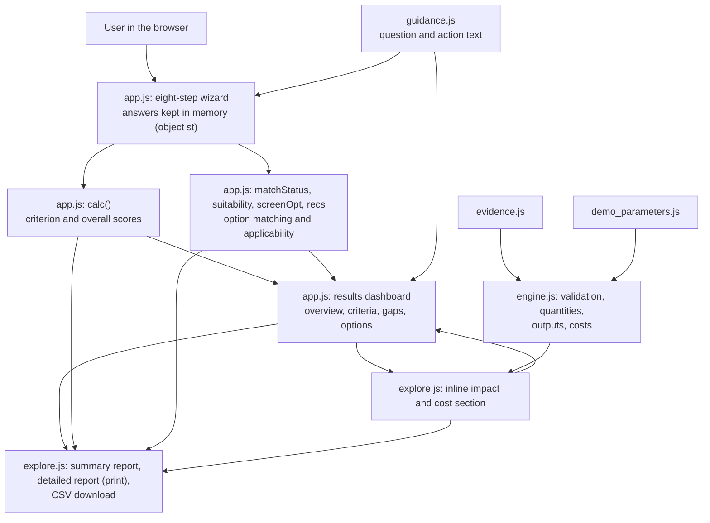
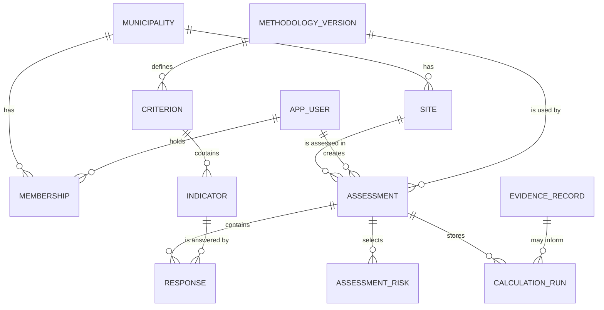

# NBS4MED Self-Evaluation Tool: Technical Documentation

**Purpose of this document.** It explains how the tool works for two kinds of reader at once: people with a background in urban planning, environmental science or nature-based solutions (NbS) who have never programmed, and technical reviewers who want to trace every result back to the code. Each major section starts with a short **plain-English** explanation, followed by **technical details** for those who want to go deeper.

**What is described.** The prototype as it exists at commit `ab74b92` of the `main` branch. Line numbers such as `app.js:564` refer to that commit. For a short introduction to the project, read [`README.md`](README.md) first. The formulas and the full parameter table are kept in [`CALCULATIONS.md`](CALCULATIONS.md); this document explains them and does not replace that file.

> **Status in one sentence.** This is a *preliminary prototype*: the scoring rubric, matching rules, evidence register and all cost parameters are provisional, have not been validated, and have not been approved by the project partners or by PROMEA (no document in the repository records such an approval). Section 10 lists what works, what is provisional, what is missing and what needs validation. Section 12 lists everything that was verified and every discrepancy found.

**Conventions.** *Hypothetical* examples are labelled as such and use invented data. **(to be confirmed)** marks information that the project team must confirm. Everything in sections 1–12 describes the application as it exists today; section 13 is a *proposal* and describes nothing that exists. **No backend, API, SQL database, user accounts or central storage of assessments exists in the current application.**

**Contents**
1. [The big picture](#1-the-big-picture)
2. [The workflow step by step, with a hypothetical example](#2-the-workflow-step-by-step-with-a-hypothetical-example)
3. [Technical terms in plain English](#3-technical-terms-in-plain-english)
4. [Project files and how they fit together](#4-project-files-and-how-they-fit-together)
5. [The scoring methodology](#5-the-scoring-methodology)
6. [How NbS options are matched](#6-how-nbs-options-are-matched)
7. [Impact and cost calculations](#7-impact-and-cost-calculations)
8. [Evidence and parameters](#8-evidence-and-parameters)
9. [Outputs: what the user sees and downloads](#9-outputs-what-the-user-sees-and-downloads)
10. [Implemented, provisional, missing and unvalidated](#10-implemented-provisional-missing-and-unvalidated)
11. [Running, reproducing and maintaining the tool](#11-running-reproducing-and-maintaining-the-tool)
12. [Verification record and discrepancies found](#12-verification-record-and-discrepancies-found)
13. [Proposed development roadmap](#13-proposed-development-roadmap)

---

## 1. The big picture

### In plain English

**What it does.** The NBS4MED Self-Evaluation Tool is a web page that asks a municipality, a project team or another organisation a structured set of questions about its situation. From the answers it:

1. shows how far nature-based solutions are already built into its policies, plans, capacity, stakeholder work and funding;
2. points out the gaps and suggests general next steps;
3. suggests which kinds of NbS may suit the climate risks and the site it described;
4. lets the user explore rough quantities, published evidence and indicative costs for five types of NbS; and
5. produces printable reports and a spreadsheet-style file.

**Why it was developed.** The project's own introduction page says that wider adoption of NbS in Mediterranean cities is held back by knowledge gaps, limited involvement of local stakeholders and little experience in planning and coordinating NbS, and that the assessment shows where an organisation is strong and where the gaps are, so that fit-for-purpose NbS can be planned before resources are committed. The tool was developed by the University of Jordan within the **NBS4MED** project (*Nature based solutions for climate resilient Mediterranean cities*), co-funded by the European Union through the **Interreg NEXT MED** Programme. The project's demonstration script names this work **Activity A3.3.2** (official title **to be confirmed**). It is described as a prototype for partner testing.

**Who can use it.** According to the introduction page: partners, public authorities and other organisations that plan or implement NbS. The live version needs no account and no installation.

**What happens from start to results.**

| Moment | What happens |
|---|---|
| The user opens the page | An introduction page explains the tool. Pressing **Start assessment** opens the assessment. |
| Steps 1–3 | The user describes the **area** (one of five NBS4MED pilot areas or any other place), the **site context** (how built-up it is and how much public land is available for NbS) and the **local climate risks** that matter. |
| Steps 4–8 | The user answers 14 questions grouped in five **criteria** (C1–C5). Each answer is a score from 0 to 2, or "Unknown", or "Not applicable". |
| Results | When all 19 questions are complete, one results page appears: overview, criteria results, gaps with suggested actions, preliminary NbS options and an impact-and-cost section. |
| Optional exploration | For a supported option, the user enters a few figures (for example a roof area) and sees quantities, published evidence and indicative costs. |
| Export | Two printable reports and one CSV file can be created. |

**What the tool does not do.** It does not store or send anything, it does not forecast local climate benefits, it does not give local prices, and it does not approve or reject a project. Its recommendations are preliminary prompts for discussion.

### Technical details

- The tool is a **static website**: a set of files that the visitor's browser opens and runs by itself (section 4). There is no server-side code. The Actions history shows the automatic `pages-build-deployment` workflow publishing the `main` branch through GitHub Pages; the exact Pages source setting is not visible in the repository files **(to be confirmed in Settings → Pages)**.
- All answers live in one in-memory JavaScript object (`st`, created at `app.js:473` by `freshState()`, `app.js:468`). Reloading or closing the page discards it. The code contains no `fetch`, `XMLHttpRequest`, form submission, `sendBeacon`, `localStorage`, `sessionStorage` or cookie use; the only external request is for fonts from Google Fonts.
- The page can be opened at specific places with a URL fragment (`#assessment`, `#results`, `#explore`, `#about`, `#how`, `#resources`); see `route()` at `app.js:1254`. `#results` falls back to the assessment while it is incomplete.

---

## 2. The workflow step by step, with a hypothetical example

### In plain English

Below, an invented organisation, **"Example City" (hypothetical)**, uses the tool. All inputs are invented. All numbers below were produced by running the tool's own code on these inputs (section 11 explains how to repeat this), and each was also checked by hand.

#### Steps 1–3: describing the situation (hypothetical inputs)

| Step | Hypothetical entry |
|---|---|
| 1. Assessment area | "Other area": name Example City, country X, city Y; scale **Municipality / City** |
| 2. Site context | Urban density **High**; public land available for NbS **Moderate** |
| 3. Local climate risks | **Heatwaves** and **Flooding** |

#### Steps 4–8: answering the 14 questions (hypothetical answers)

| Indicator | Answer | Indicator | Answer |
|---|---|---|---|
| 1.1 NBS inventory | 2 | 3.3 Data and monitoring tools | 1 |
| 1.2 Coverage of public space | 1 | 4.1 Community participation | 2 |
| 1.3 Link to grey infrastructure | 0 | 4.2 Coordination across departments and owners | **Not applicable** (justification: "no NGOs operate in this area") |
| 2.1 NBS in strategic plans | 1 | 5.1 Capital funding | 1 |
| 2.2 Regulation and standards | 2 | 5.2 Long-term maintenance budget | 0 |
| 2.3 Targets and monitoring | 0 | 5.3 Co-benefits valued in decisions | 0 |
| 3.1 Dedicated staff or unit | 1 | | |
| 3.2 Technical know-how | **Unknown** | | |

#### What the tool computes from these answers

**Scores (first run, with 3.2 Unknown).** Each criterion's points are divided by the maximum possible for the *scored* indicators (2 points each):

| Criterion | Calculation | Result |
|---|---|---|
| C1 NBS Integration Status | (2 + 1 + 0) / (3 × 2) = 3/6 | **50%** |
| C2 Policy & Planning | (1 + 2 + 0) / 6 = 3/6 | **50%** |
| C3 Institutional & Technical Capacity | 3.2 is Unknown | **Not rated** (2 of 3 indicators scored; the lowest scored answer is shown instead) |
| C4 Stakeholder Engagement | 4.2 is Not applicable, so only 4.1 counts: 2/2 | **100%** (see the caution in section 5.5) |
| C5 Funding & Sustainability | (1 + 0 + 0) / 6 = 1/6 | **17%** |
| Combined (overall) score | one indicator is Unknown | **Not shown** until 3.2 is resolved |

**After the Unknown is resolved (3.2 answered 1).** C3 becomes 3/6 = **50%** and the overall score becomes (3 + 3 + 3 + 2 + 1) / (13 × 2) = 12/26 = 46.15%, shown as **46%**, level **Partial**. The 13 in the denominator is the number of *scored* indicators (14 minus the one Not applicable).

**Gaps and actions.** Answers of 0 are listed as *Gap* (1.3, 2.3, 5.2, 5.3), answers of 1 as *Partial* (1.2, 2.1, 3.1, 3.3, 5.1; and 3.2 after it is resolved), and Unknown as *To verify* (3.2 in the first run). Each item shows the rubric text the user chose, a suggested action, why it matters and the evidence needed.

**Matching.** With heatwaves and flooding selected, density High and moderate public land, the nine options receive these provisional match scores (formula and weights in section 6):

| Option | Match score | Option | Match score |
|---|---|---|---|
| Urban forest | 67 | Smart eco-park | 58 |
| Green roof | 67 | Permeable paving | 50 |
| Green corridor | 67 | Pocket park | 50 |
| Rain garden and bioswale | 67 | Rainwater retention basin | 42 |
| | | Vegetated dune and shoreline | 17 |

Four options tie at 67; ties are shown in the fixed list order, so the three cards shown are Urban forest, Green roof and Green corridor (section 6.5 explains why this order is arbitrary).

**Applicability check (optional).** The user opens **Check this solution** on the green roof and answers: roof available = Yes; structural suitability = Unknown. The status becomes **Requires verification**, because an essential condition is not confirmed. This status does not change the match score.

**Impact and cost, green roof (hypothetical inputs: roof area 800 m², design rainfall event 30 mm, default substrate depth 0.08 m, waterproofing included).**

| Result | Value | What it is |
|---|---|---|
| Rain falling on the roof in the event | **24 m³** | Simple arithmetic: 800 m² × 30 mm / 1000 |
| Rainwater retained in this single event | **6.43 – 14.8 m³** | Published *range* applied as a scenario, not a forecast for this roof |
| Substrate volume to buy | **64 m³** | 800 m² × 0.08 m |
| Construction cost (CAPEX), low / base / high | **23,240 / 41,860 / 78,160 EUR** | Illustrative scenario range from demo assumptions |
| Annual maintenance (OPEX), low / base / high | **800 / 2,000 / 4,000 EUR** | Illustrative scenario range from demo assumptions |
| Published reference cost for 800 m² | **23,200 – 58,400 EUR (median 35,200)** | Hamburg cases, 2017 prices; not a local price |

**Exports.** The user can print the two-page summary, print the detailed report, or download the CSV.

### Technical details

- The question flow is defined by `STEPS` (`app.js:464`): `scope`, `ctx`, `risk`, then `crit` 0–4. `TOTAL_Q = 2 + 2 + 1 + 14` (`app.js:466`): area (1), scale (1), density and land (2), risks (1), indicators (14). The results page opens only when `allComplete()` is true.
- "Fill with sample data" (`fillSample`, `app.js:1387`) loads a clearly labelled fictitious sample for testing; it is unrelated to the example above.
- The İzmir green-roof scenario used for the project's demonstration video (area 800 m², event 30 mm) is documented in [`DEMO_VIDEO_PACKAGE.md`](DEMO_VIDEO_PACKAGE.md); the green-roof figures above are the engine's output for the same two inputs.

---

## 3. Technical terms in plain English

| Term | What it means | Why it matters here |
|---|---|---|
| **Static website** | A site made only of files that the browser reads and runs. No computer on the internet processes the user's data. | It is why no answers are stored or sent anywhere. |
| **HTML / CSS** | HTML is the page's content and structure; CSS is its appearance (colours, layout, right-to-left Arabic, print layout). | Both are in `index.html`. |
| **JavaScript** | The programming language browsers run. It contains all the rules and calculations. | `app.js`, `explore.js`, `engine.js` and `guidance.js` are JavaScript. |
| **JSON** | A plain-text way to store structured data (lists and labelled values) that both people and programs can read. | `evidence.json` and `demo_parameters.json` hold the evidence and the demonstration parameters. |
| **Scoring logic** | The exact rules that turn answers into numbers. | Section 5. |
| **Rubric** | The description of what a 0, 1 and 2 mean for one question. | Section 5 and the appendix of indicator rubrics. |
| **Rule-based matching** | Choosing options by fixed, written rules (weights and conditions), not by a statistical or learned model. | Section 6. It is transparent, but only as good as its rules. |
| **Weight** | A number saying how strongly an option addresses a risk (0 to 3). | Used to compute the match score. |
| **Applicability check** | A few optional yes/no/unknown questions about a specific option (for example "is there a roof?"). | It shows whether the option can plausibly be pursued; it is not engineering approval. |
| **Data validation** | Automatic checks that an entry is complete and sensible (not blank, not negative, within allowed limits). | The wizard blocks "Next" on missing answers; calculators reject invalid numbers. |
| **In-memory state** | Information held only while the page is open. | Why nothing survives a reload. |
| **Provisional** | Working version, not yet reviewed or approved. | Applies to the rubric, thresholds, weights and costs. |
| **Demo assumption / published reference** | Two labels for numbers. A demo assumption was chosen by the demo authors only so a calculation can run. A published reference comes from a cited publication, with that publication's limits. | Section 8. |
| **Scenario range (low / base / high)** | Three alternative assumption sets, not a statistical confidence interval. | Section 7. |
| **CAPEX / OPEX** | Capital (one-off construction) cost and operating (annual maintenance) cost. | Always shown separately and never added together. |
| **URL fragment** | The part of a web address after `#`. | `#assessment` opens the assessment directly. |
| **SVG** | A drawing format built from text; browsers draw it sharply at any size. | All charts are inline SVG. |
| **CSV** | A plain table file that spreadsheet programs open. | The data export. |
| **Print to PDF** | The browser's print dialog can save a page as PDF. | How the two reports become PDF files. |

---

## 4. Project files and how they fit together

### In plain English

Everything is in one folder. The page loads a few script files in a fixed order; two data files hold the evidence and the demonstration numbers; one script does the calculations, one does the assessment and results, one draws the impact-and-cost section and the reports, and one holds the question texts.

| File | What it is for, in plain English | How it connects to the rest |
|---|---|---|
| `index.html` | The page itself: the introduction, the footer and all the visual styling. It also loads the other files. | Loads every script below, in order. |
| `app.js` | The "brain" of the assessment: the questions' structure, the 14 indicators, the scoring, the option matching, the screening checks, the results dashboard and the page navigation. | Uses `guidance.js` for question texts and `explore.js` for the impact-and-cost section and exports. Offers its results to `explore.js`. |
| `guidance.js` | The wording for each question (English and Arabic): explanation, why it matters, suggested actions and the evidence needed. | Read by `app.js`. |
| `engine.js` | The calculator: checks entries, computes quantities and costs. It never touches the page. | Reads the two data files. Used by `explore.js`. |
| `explore.js` | The impact-and-cost section on the results page, plus both printable reports and the CSV. | Asks `engine.js` for every number and `app.js` for the assessment state. |
| `evidence.json` and `evidence.js` | The evidence register: published findings and costs, sources, rules for using them. The `.js` file is a copy of the `.json` file so the page also works when opened from a disk. | Read by `engine.js` and `explore.js`. |
| `demo_parameters.json` and `demo_parameters.js` | The demonstration numbers: calculator inputs (with defaults and limits), unit prices and other assumptions. Same copy arrangement. | Read by `engine.js` and `explore.js`. |
| `CALCULATIONS.md` | The reference list of formulas and parameter values. | Documentation. |
| `GAP_ACTION_LOGIC.md` | How answers become gaps and suggested actions. | Documentation. |
| `assets/nbs4med-interreg-eu-logo.png` | The funding-acknowledgement logo in the footer. | Used by `index.html`. |
| `run-demo.bat` | A Windows shortcut that starts a small local web server and opens the page. | Optional. |
| `qa-tests/`, `qa-evidence/`, `redesign-evidence/`, `branding-evidence/`, `header-logo-evidence/` | Browser test scripts and the screenshots and sample files they produced. | Records only; not needed to run the tool. |
| `README.md`, `FINAL_QA_REPORT.md`, `REDESIGN_REPORT.md`, `BRANDING_ASSETS.md`, `DEMO_VIDEO_PACKAGE.md` | Project introduction, quality-assurance record, redesign notes, logo notes and the İzmir demonstration scenario. | Documentation. |

### Technical details

**Technology.** HTML5; CSS inside `index.html` (responsive breakpoints, right-to-left support, reduced-motion support and `@media print` rules); plain browser JavaScript in an older style (`var`, functions, no modules, no framework, no build step); JSON data; inline SVG; Google Fonts (Source Sans 3, Source Serif 4, IBM Plex Sans Arabic; the only external request); the browser's `window.print()` and a Blob download; GitHub Pages hosting. There is no `package.json`, bundler or dependency. `app.js` has about 1,420 lines, `explore.js` 1,170, `engine.js` 300 and `guidance.js` 160.

**Load order** (`index.html`; order matters because later files read the objects created by earlier ones): `evidence.js` → `demo_parameters.js` → `engine.js` → a one-line script calling `NBS4MED_ENGINE.init(NBS4MED_EVIDENCE, NBS4MED_PARAMS)` → `explore.js` → `guidance.js` → `app.js`. The shared objects are `window.NBS4MED_EVIDENCE`, `NBS4MED_PARAMS`, `NBS4MED_ENGINE`, `NBS4MED_EXPLORE`, `NBS4MED_GUIDE` and `NBS4MED_CORE` (`app.js:1411`).



**Data flow in words.** (1) The wizard stores each answer in `st`. (2) `calc()` (`app.js:564`) computes scores from the 14 indicator answers only. (3) `recs()` (`app.js:666`) computes option match scores from the risks and site context only, then merges the optional screening results. (4) `explore.js` calls `NBS4MED_ENGINE.calculate(solutionId, inputs, touched, prices)` (`engine.js:182`) for the selected option. (5) The reports and the CSV re-use the same state. The three streams (assessment scores, matching and screening, impact and cost) never feed into each other.

---
## 5. The scoring methodology

### In plain English

The assessment has **5 criteria** and **14 indicators** (questions). For each indicator the user picks the description that best matches their situation. Each description is worth 0, 1 or 2 points. A criterion's result is the points earned divided by the points possible, as a percentage. If the user cannot answer a question they choose **Unknown**; if it does not apply they choose **Not applicable** and must say why. These two choices are never treated as a zero.

**The important rules in one table**

| Situation | What the tool does |
|---|---|
| An indicator is answered 0, 1 or 2 | The points count, and 2 points are added to the maximum. |
| An indicator is **Unknown** | No points and no maximum are added. Its criterion shows **no percentage** ("Not rated") and the overall score is **hidden** until it is resolved. It is not a weak result and it is not a zero. |
| An indicator is **Not applicable** | A written justification is required. It adds nothing to points or maximum, so it is simply left out of the calculation. |
| A question is unanswered | The wizard will not let the user move on, so results are not reachable. |

The overall ("combined") score is a **secondary**, provisional figure. The tool itself says it is not a validated measure of NBS integration, and it keeps C1 (existing NbS integration) visually separate from C2–C5 (the conditions that enable or limit implementation).

### 5.1 Criteria and indicators

| Criterion | Indicators |
|---|---|
| **C1** NBS Integration Status | 1.1 NBS inventory · 1.2 Coverage of public space · 1.3 Link to grey infrastructure |
| **C2** Policy & Planning | 2.1 NBS in strategic plans · 2.2 Regulation and standards · 2.3 Targets and monitoring |
| **C3** Institutional & Technical Capacity | 3.1 Dedicated staff or unit · 3.2 Technical know-how · 3.3 Data and monitoring tools |
| **C4** Stakeholder Engagement | 4.1 Community participation · 4.2 Coordination across departments and owners |
| **C5** Funding & Sustainability | 5.1 Capital funding · 5.2 Long-term maintenance budget · 5.3 Co-benefits valued in decisions |

Defined in `CRIT` and `IND` (`app.js:10`, `app.js:17`). The full three-level rubric for every indicator is in the [appendix](#appendix-the-indicator-rubrics). The code states that these descriptions are a **provisional project rubric for partner review** against the PROMEA framework and the NBS repository.

### 5.2 Possible responses

| Response | Stored as | Counts toward points | Counts toward maximum | Notes |
|---|---|---|---|---|
| 0, 1 or 2 | the number | yes | +2 | The chosen rubric text is kept as the "finding". |
| Unknown | `'U'` | no | no | Makes the criterion and the overall result "incomplete". |
| Not applicable | `'NA'` | no | no | Needs a non-empty justification (`indOk`, `app.js:513`). |
| Unanswered | nothing | no | no | Blocks progress (`stepMissing`, `app.js:686`). |

Each indicator also accepts optional extras that never affect any score: a short rationale, a description of the evidence, and a confidence level (High: documented evidence; Medium: staff estimate; Low: informal judgement). Confidence is summarised separately in the overview. Indicator 1.2 additionally asks two yes/no/unknown questions about a local target and known coverage; they are recorded in the reports but are not used in the score.

### 5.3 The formulas (from `calc()`, `app.js:564`)

For each criterion *c*, let *n* be the number of its indicators scored 0, 1 or 2, and let *S* be the sum of those scores. Then:

```
maximum_c   = 2 × n
status_c    = "incomplete"  if any indicator of c is Unknown or unanswered
            = "na"          if none is open but n = 0 (all Not applicable)
            = "complete"    otherwise
percentage_c = round( 100 × S / (2 × n) )          only when status_c = "complete"; otherwise none
```

The code is:

```js
p.max=p.scored*2;
p.open=p.unk+p.un;
p.status=p.open>0?'incomplete':(p.scored===0?'na':'complete');
p.pct=p.status==='complete'?Math.round(p.sum/p.max*100):null;
```

The **overall** result uses exactly the same formula over all 14 indicators together (`ov` in `calc()`): total points ÷ (2 × total number of scored indicators), shown only when nothing is open. It is therefore *not* the average of the five criterion percentages; each scored indicator has equal weight, so a criterion with more scored indicators influences the total more.

**Levels** (`lvlIdx`, `app.js:485`; names in `LEVELS`, `app.js:103`) are applied to the *rounded* percentage:

| Percentage | Level |
|---|---|
| below 30 | Insufficient |
| 30 to 54 | Partial |
| 55 to 79 | Adequate |
| 80 and above | Strong |

The thresholds are labelled in the tool as provisional project thresholds, not taken from any external standard.

### 5.4 Worked examples (hypothetical "Example City"; answers as in section 2)

| | First run (3.2 Unknown, 4.2 Not applicable) | After 3.2 is answered 1 |
|---|---|---|
| C1 | 3 / 6 → **50%** Partial | 3 / 6 → **50%** |
| C2 | 3 / 6 → **50%** Partial | 3 / 6 → **50%** |
| C3 | incomplete → **not rated** (2 of 3 scored, 1 Unknown) | 3 / 6 → **50%** |
| C4 | 4.1 = 2, 4.2 excluded → 2 / 2 → **100%** Strong | 2 / 2 → **100%** |
| C5 | 1 / 6 → **17%** Insufficient (1/6 = 16.67, rounded) | 1 / 6 → **17%** |
| Overall | 11 / 24 points, but one Unknown → **not shown** | 12 / 26 → 46.15 → **46%**, Partial |

The overall figure in the second column is 12 points from 13 scored indicators: (3 + 3 + 3 + 2 + 1) / (13 × 2).

**Effect of Unknown and Not applicable on the final score.** In the example, resolving the Unknown moves the overall result from "not shown" to 46%. Marking 4.2 Not applicable removed it from both the points and the maximum; if 4.2 had instead been scored 1, C4 would be 3/4 = 75% and the overall result 13/28 = 46.4% → 46% (same rounded value in this case). So Unknown never *lowers* a score but withholds it; Not applicable changes the percentages only by shrinking the set of indicators used.

### 5.5 Behaviours that need attention (flagged, not guessed)

1. **A single remaining indicator can give 0% or 100%.** The code has no minimum number of scored indicators. In the example, C4 shows 100% from one answer because the other indicator is Not applicable. Whether a minimum should apply is a methodological decision for the project.
2. **Levels use the rounded percentage.** For example 12 points out of 22 is 54.55% and rounds to 55%, so it is reported as *Adequate* although the unrounded value is below 55 (verified by running the code).
3. **Equal weights and a mixed overall score.** All indicators weigh the same, so C4 (two indicators) counts less in the total than the other criteria (three each). The overall score also mixes C1 with C2–C5. The tool labels the overall score as secondary and provisional; see also [`GAP_ACTION_LOGIC.md`](GAP_ACTION_LOGIC.md), which lists further observations.
4. **One Unknown hides a whole criterion.** This is conservative and avoids false precision, but a criterion with two good answers and one Unknown shows no percentage. The tool shows "2 of 3 indicators scored" and the lowest scored answer instead.
5. **Unused value.** `calc()` also returns `weak` (the criterion with the lowest percentage), but no other code uses it in the current interface.
6. **Rubrics are provisional.** Indicator 1.2 mixes coverage with an optional local target in one scored answer; indicator 5.1 assumes a plan for the NbS exists.

### 5.6 From answers to gaps and actions

`gapItemsRaw()` (`app.js:1139`) lists every indicator answered 0 (*Gap*), 1 (*Partial*) or Unknown (*To verify*); 2 and Not applicable are not listed. The finding is the rubric text the user selected (for Unknown: a fixed sentence saying it is missing information, not weak performance). The suggested action, "why it matters" and "evidence needed" come from `guidance.js` and are the same for every user giving that answer, so they are **general prompts, not findings about the site**. Items are ordered by tier (0, then 1, then Unknown), then by indicator number; the page shows the first five and puts the rest behind "Show all". This is a transparent display order, not a validated priority ranking. Full details: [`GAP_ACTION_LOGIC.md`](GAP_ACTION_LOGIC.md).

### 5.7 What the assessment score is *not*

It is not used anywhere else: not in the option match score, not in applicability checks, not in the impact and cost calculators. Funding, maintenance and technical-capacity answers (5.1, 5.2, 3.2) are shown beside recommendations as "shared implementation conditions", but they change no number.

### Appendix: the indicator rubrics

| Indicator | Score 0 | Score 1 | Score 2 |
|---|---|---|---|
| **1.1** NBS inventory (C1) | No inventory of existing NBS exists. | An inventory exists but is incomplete or needs updating. | An inventory covers the assessment area and records NBS type, location and condition. |
| **1.2** Coverage of public space (C1) | Public space with green or blue features is known to be minimal, or no such features are present in the area. | Some public space has green or blue features, but coverage is partial or uneven, or falls short of a local target where one exists. | Green or blue features are widespread across the public space of the area, and meet a local target where one exists. |
| **1.3** Link to grey infrastructure (C1) | NBS are planned separately from drainage, roads and buildings, or not linked to them at all. | Some projects are coordinated with grey infrastructure, but this is not routine practice. | NBS are routinely planned together with drainage, roads and buildings in the area. |
| **2.1** NBS in strategic plans (C2) | NBS are not mentioned in the climate adaptation, master or sector plans that apply to the area. | NBS are mentioned in some plans, but without specific measures, locations or responsibilities. | NBS appear in the applicable plans with specific measures, locations or responsibilities. |
| **2.2** Regulation and standards (C2) | No zoning rule, building code or green-area standard requires or rewards NBS. | Some rules or standards encourage NBS, but they are voluntary, partial or rarely applied. | Rules or standards require or reward NBS and are applied to projects in the area. |
| **2.3** Targets and monitoring (C2) | No measurable NBS targets exist. | Targets exist but are not measurable, or progress is not reported regularly. | Measurable NBS targets exist and progress is reported on a regular schedule. |
| **3.1** Dedicated staff or unit (C3) | No unit or named staff are responsible for NBS. | Staff handle NBS alongside other duties, or responsibility is limited to one department. | A unit or named staff are responsible for NBS and work across departments. |
| **3.2** Technical know-how (C3) | Staff and contractors have little or no experience in designing, building or managing NBS, and no guidance exists. | Some experience or guidance exists, but it is limited to certain NBS types or relies on outside support. | Staff or contractors can design, build and manage NBS, and guidance documents are available. |
| **3.3** Data and monitoring tools (C3) | Climate, land-use and NBS data are not available, or are not used in decisions. | Some data exist, but they are incomplete, out of date or only occasionally used in decisions. | Climate, land-use and NBS data are available and used in decisions. |
| **4.1** Community participation (C4) | Residents are not involved in planning or designing NBS. | Residents are consulted, but mostly after the main decisions have been made. | Residents help set priorities or design NBS from an early stage. |
| **4.2** Coordination across departments and owners (C4) | Departments, utilities and private owners do not coordinate on NBS actions. | Coordination happens case by case, or only between some of the actors. | Departments, utilities and private owners coordinate on NBS actions through a regular mechanism. |
| **5.1** Capital funding (C5) | No funding for building NBS is secured or realistically available. | Some funding is secured or likely, but it does not cover the planned NBS. | Funding for building the planned NBS is secured or realistically available. |
| **5.2** Long-term maintenance budget (C5) | No budget covers maintenance, watering or replacement of NBS. | A maintenance budget exists, but it is short-term, partial or not guaranteed. | A long-term budget covers upkeep, watering and replacement. |
| **5.3** Co-benefits valued in decisions (C5) | Co-benefits such as cooling, health and flood protection are not counted in funding decisions. | Co-benefits are mentioned in funding decisions, but are not measured or valued. | Co-benefits are measured or valued and counted in funding decisions. |

---

## 6. How NbS options are matched

### In plain English

The tool compares nine NbS options with the **climate risks** and **site context** the user entered in steps 2 and 3. Each option has a set of written weights saying how strongly it addresses heatwaves, flooding and drought. The tool adds up the weights for the selected risks, converts the total to a number out of 100, and lowers it when the option needs more public land than is available or when the area is very densely built. The result is a **provisional match score**. Options are listed from highest to lowest.

**It is guidance, not a decision.** The weights and adjustments are provisional demonstration rules without PROMEA validation. The score is not a probability of success, a feasibility study or a predicted impact, and it ignores the assessment answers. A real decision would also need local engineering, ecological and financial studies.

### 6.1 The rules in the code

**Options and weights** (`OPT`, `app.js:106`). Weights run from 0 (not a target) to 3 (strongly addresses). "Land need" and "technical complexity" run from 0 (low) to 2 (high). An option has a calculator only where an NBS identifier is given.

| Option | Heatwaves | Flooding | Drought | Land need | Complexity | Calculator |
|---|---|---|---|---|---|---|
| Urban forest (Miyawaki method) | 3 | 1 | 1 | 1 (Medium) | 1 (Medium) | NBS01 |
| Green roof | 2 | 2 | 1 | 0 (Low) | 2 (High) | NBS02 |
| Green corridor | 3 | 1 | 0 | 0 (Low) | 0 (Low) | NBS05 |
| Rain garden and bioswale | 1 | 3 | 1 | 1 (Medium) | 1 (Medium) | none |
| Permeable paving | 0 | 3 | 1 | 0 (Low) | 0 (Low) | none |
| Pocket park | 2 | 1 | 0 | 1 (Medium) | 0 (Low) | none |
| Smart eco-park | 3 | 2 | 2 | 2 (High) | 2 (High) | NBS03 |
| Rainwater retention basin | 1 | 3 | 3 | 2 (High) | 2 (High) | NBS04 |
| Vegetated dune and shoreline | 0 | 1 | 0 | 1 (Medium) | 1 (Medium) | none |

**When matching is produced** (`matchStatus`, `app.js:487`). No match score or ranking is produced, and an explanatory message is shown instead, if: "Not sure" is selected; no risk is selected; any selected risk is coastal storms or land degradation (no rules exist for them); urban density or public land has not been given; or public land is **Unknown**.

**The formula** (`rawMatch` and `suitability`, `app.js:614`–`625`). Let *n* be the number of selected risks and *raw* the sum of the option's weights for those risks.

```
base       = raw / (3 × n) × 100
land_avail = 0 if public land is Limited, 1 if Moderate, 2 if Abundant
if land_need > land_avail:               base = base − 15 × (land_need − land_avail)
if density is High and land_need = 2:    base = base − 10
score      = clamp( round(base), 0, 100 )
```

**Ranking** (`recs`, `app.js:666`). Options marked *Not applicable* by the screening checks are set aside and listed separately with their reasons. Of the rest, options with a score above 0 are sorted from highest to lowest score; equal scores keep the fixed list order above. The top three are shown as cards. Options with a score of 0 appear under "Other options" with the reason (none of the selected risks is a target of that option), never described as technically unsuitable.

### 6.2 Worked example 1 (hypothetical "Example City": heatwaves + flooding, High density, Moderate public land, so *n* = 2, denominator = 6, `land_avail` = 1)

| Option | raw | base = raw/6×100 | Land adjustment | Density adjustment | Final |
|---|---|---|---|---|---|
| Urban forest | 3 + 1 = 4 | 66.7 | none (need 1 ≤ 1) | none | **67** |
| Green roof | 2 + 2 = 4 | 66.7 | none | none | **67** |
| Green corridor | 3 + 1 = 4 | 66.7 | none | none | **67** |
| Rain garden and bioswale | 1 + 3 = 4 | 66.7 | none | none | **67** |
| Smart eco-park | 3 + 2 = 5 | 83.3 | −15 (need 2 > 1) | −10 (High density, need 2) | **58** |
| Permeable paving | 0 + 3 = 3 | 50.0 | none | none | **50** |
| Pocket park | 2 + 1 = 3 | 50.0 | none | none | **50** |
| Rainwater retention basin | 1 + 3 = 4 | 66.7 | −15 | −10 | **42** |
| Vegetated dune and shoreline | 0 + 1 = 1 | 16.7 | none | none | **17** |

### 6.3 Worked example 2 (hypothetical: flooding only, High density, Limited public land, so *n* = 1, denominator = 3, `land_avail` = 0)

Permeable paving 3/3 = 100 (need 0, no adjustment) → **100**; rain garden and bioswale 100 − 15 (need 1 > 0) → **85**; green roof 2/3 = 66.7 → **67**; retention basin 100 − 30 − 10 → **60**; green corridor 33; smart eco-park 66.7 − 30 − 10 → 27; urban forest, pocket park and dune each 33.3 − 15 → 18. The top three cards are therefore permeable paving, rain garden and bioswale, and green roof.

### 6.4 Optional applicability checks

Each option has a short list of yes / no / unknown questions (`CHK`, `app.js:124`; which questions apply to which option: `RULE`, `app.js:167`). Examples: *Is there a roof that could host a green roof?*; *Is there a runoff source that could drain to a rain garden?*; *Is there a catchment that could feed a retention basin?* A follow-up question is hidden when its prerequisite is answered No (`DEP`, `app.js:166`). Answers are kept per question while the page is open.

| Status (`screenOpt`, `app.js:635`) | When it applies |
|---|---|
| Not yet checked | No relevant question has been answered. |
| Requires verification | A shown check is unanswered or Unknown, or a condition that can still be assessed or designed (for example soil or infiltration) is answered No. |
| Preliminary candidate | Every shown check is answered Yes. |
| Not applicable | An *essential* prerequisite is answered No (for example no roof, no planting space, no coastal location), or the roof is assessed as unsuitable. |

**Unknown never excludes an option.** For the green roof, the structural check has three states: *Confirmed suitable*, *Assessment pending or Unknown* (never "unsuitable"), and *Assessed and unsuitable*. The status is shown beside the option and does **not** change its match score.

### 6.5 Why the result must be read as preliminary

- The weights (0–3), land adjustments (−15, −10) and complexity labels are **provisional demonstration rules**; no document in the repository records their validation by PROMEA or the partners.
- Only three risks have rules; coastal storms and land degradation produce no matching at all.
- Ties are resolved by the fixed list order, not by merit. In example 1 the green roof is shown because it comes second in the list among four options with the same score.
- The match score ignores the assessment answers, the actual site geometry, cost and local regulations. The tool states this on screen.
- Data in `OPT` for fire and air-quality weights and for coastal weights exist but are not used: no fire or air-quality risk can be selected, and any coastal selection stops matching.
- The solution categories (green infrastructure, blue-green water management, ecosystem restoration, hybrid/integrated) are provisional display labels only; they affect neither matching nor calculators.

---

## 7. Impact and cost calculations

### In plain English

For five of the nine options the user can type a few figures about a planned project (for example the roof area) and see:

1. **Physical quantities**: simple arithmetic such as how much substrate to buy or how many trees fit.
2. **Resource needs**: for example the water needed to establish planting, using demonstration water-demand rates.
3. **Published evidence**: for the green roof only, a published range of rainwater retention, applied as a labelled scenario.
4. **Indicative cost**: a sum of quantity × unit price over cost components, as three scenarios (low, base, high). Construction cost (CAPEX) and yearly maintenance (OPEX) are always shown separately.

None of this is a forecast for the user's site, and none of the prices are local prices. The tool states in the interface that *quantitative local climate-risk mitigation impact is not currently estimated*.

### 7.1 General rules (`engine.js`)

- **Checks on the entries** (`resolveInputs`, `engine.js:84`): defaults fill optional blanks; a blank required value gives an error; commas are read as decimal points; zero, negative, non-numeric or out-of-range values are rejected. A missing value is **never** treated as zero.
- **Validity warnings.** Beyond the hard limits, each calculator has a narrower range for which the demo parameters were set (urban forest area 100–10,000 m²; green roof 50–5,000 m²; eco-park 500–50,000 m²; retention basin footprint 100–5,000 m²; green corridor length 50–2,000 m). An entry outside it is *accepted* with a warning. A warning also appears when the design rainfall depth is left at its default.
- **Cost builder** (`buildCosts`, `engine.js:122`): `CAPEX = Σ(quantity × unit price)` and `Annual cost = Σ(quantity × annual unit cost)`, each computed with the low, base and high value of every unit price. Low is the sum of all low prices and high the sum of all high prices, so the range is an *illustrative scenario range*, not a confidence interval. A user-entered unit price replaces the three scenario values and the result is labelled as user-entered or mixed. Lump sums do not scale with area and no economies of scale are modelled. Land purchase, VAT unless stated, utility relocation, contingency, financing and replacement beyond annual maintenance are excluded.
- **Not calculated, by design:** air temperature, surface temperature and thermal comfort; annual retention; peak-flow reduction; annual captured volume; flood-risk reduction; and any aggregate impact of a multi-component park. The interface lists each with the reason.
- **Source labels.** Every output is labelled *arithmetic on your inputs*, *demo assumption* or *published reference*.

All unit prices and rates below are **demonstration assumptions** (class `demo_assumption`; none partner-validated) unless stated. The same values are in the table of [`CALCULATIONS.md`](CALCULATIONS.md); the cross-check in section 12 found no difference between that table and the data file.

### 7.2 Urban forest (Miyawaki method), calculator NBS01

**What it estimates.** The number of plants to buy, the water needed to establish the planting, and indicative costs. It does **not** estimate cooling, air quality or stormwater effects.

**Inputs the user provides.**

| Input (id) | What the user enters | Unit | Default | Allowed range | Required |
|---|---|---|---|---|---|
| Planted area (`area_m2`) | Ground area that will be planted, measured in plan view in square metres | m² | 2000 | 1 to 100000 | yes |
| Planting density (`density_per_m2`) | Number of plants per square metre. Dense multi-layer planting uses higher values | plants/m² | 3 | 0.5 to 10 | no |
| Irrigation days per year (`water_days`) | Number of days per year on which the planting is watered during establishment | days/year | 120 | 1 to 365 | no |


**Formulas.** `plants = ceil(A × d)` (F-N01-PLANTS); `V = A × q × n / 1000` in m³ per year (F-N01-WATER), where *A* is the planted area, *d* the planting density, *q* the establishment water demand in litres per m² per day (low / base / high) and *n* the irrigation days.

**Cost components and demonstration prices** (low / base / high):

| Cost component | Quantity used | Capital cost parameter | low / base / high | Unit | Annual cost parameter | low / base / high | Unit |
|---|---|---|---|---|---|---|---|
| sapling | plants (plants) | `NBS01.sapling_price` | 2 / 4 / 8 | EUR/plant | – | – | – |
| soil | area_m2 (m²) | `NBS01.soil_prep` | 3 / 6 / 12 | EUR/m² | – | – | – |
| planting | area_m2 (m²) | `NBS01.planting_labour` | 2 / 4 / 8 | EUR/m² | – | – | – |
| irrigation | area_m2 (m²) | `NBS01.irrigation_setup` | 1 / 2.5 / 5 | EUR/m² | – | – | – |
| design | lump (lump sum) | `NBS01.design_lump` | 1500 / 3000 / 6000 | EUR (lump sum) | – | – | – |
| maintenance | area_m2 (m²) | – | – | – | `NBS01.maintenance_annual` | 1.5 / 3 / 6 | EUR/m²/year |

**Other demonstration parameters:**

| Other parameter | Meaning | low / base / high | Unit |
|---|---|---|---|
| `NBS01.water_demand_lpd` | Establishment water demand | 2 / 4 / 8 | L/m²/day |


**Numerical example (hypothetical: 2,000 m², 3 plants/m², 120 days).** Plants = 6,000. Water = 2,000 × 4 × 120 / 1000 = **960 m³/year** (base; 480 low, 1,920 high). CAPEX base = 6,000 × 4 + 2,000 × 6 + 2,000 × 4 + 2,000 × 2.5 + 3,000 = 24,000 + 12,000 + 8,000 + 5,000 + 3,000 = **52,000 EUR** (low 25,500; high 104,000). Annual base = 2,000 × 3 = **6,000 EUR** (low 3,000; high 12,000).

**What it means.** A rough quantity and a cost scenario for planning discussions. **What it does not mean.** No local price, no impact estimate, and no statement that water is available or that the site suits drought conditions (rule R03).

### 7.3 Green roof, calculator NBS02

**What it estimates.** Rain falling on the roof in one design event, the substrate volume to buy, a published range of rainwater retention for one event, a published reference cost, and indicative costs.

**Inputs the user provides.**

| Input (id) | What the user enters | Unit | Default | Allowed range | Required |
|---|---|---|---|---|---|
| Roof area to green (`area_m2`) | Total roof area that will receive the green roof, in plan view. Published cost cases use total roof area | m² | 500 | 1 to 100000 | yes |
| Design rainfall event depth (`storm_depth_mm`) | Rain depth of one single storm event used for the retained-volume scenario. Replace the default with a depth that is relevant to your site | mm | 25 | 1 to 300 | yes |
| Substrate depth (`substrate_depth_m`) | Thickness of the growing substrate. Extensive roofs are usually thin. It sets the substrate volume to buy | m | 0.08 | 0.04 to 0.3 | no |
| Include new root-resistant waterproofing (`include_waterproofing`) | Tick if the roof needs new waterproofing. The Hamburg reference cost does not include it | – | yes | yes/no | no |


**Formulas.**
- `V_rain = A × h / 1000` m³ (F-N02-RAIN): the water that falls on the roof; it is *not* retention.
- `V_ret = V_rain × r` m³ per single event (F-N02-RET), with *r* = **26.8% to 61.8%**, the published range of mean per-event retention of nine experimental roof configurations in the UK for events above 10 mm (evidence record G01, source S06). It is applied **only if h > 10 mm**; at 10 mm or below no number is shown (the record G02 gives a typical value above 80% for small events but states it is not a guaranteed bound, so it is not used in a calculation). No central estimate is given.
- `V_sub = A × t` m³ (F-N02-SUB): substrate volume, *t* being the substrate depth.
- `C_ref = A × c_case` EUR (F-REF-ROOF): the area multiplied by each of seven published cost cases for extensive roofs in Hamburg (29, 43, 43, 44, 47, 53 and 73 EUR per m² of total roof area, 2017 prices, VAT included, root-resistant waterproofing excluded; minimum 29, median 44, maximum 73). It is shown only for areas between 196 and 1,944 m², the range of those cases.

**Cost components and demonstration prices** (low / base / high):

| Cost component | Quantity used | Capital cost parameter | low / base / high | Unit | Annual cost parameter | low / base / high | Unit |
|---|---|---|---|---|---|---|---|
| substrate | substrate_m3 (m³) | `NBS02.substrate_price` | 60 / 90 / 140 | EUR/m³ | – | – | – |
| drainage | area_m2 (m²) | `NBS02.drainage_layer` | 5 / 8 / 14 | EUR/m² | – | – | – |
| vegetation | area_m2 (m²) | `NBS02.vegetation` | 6 / 12 / 25 | EUR/m² | – | – | – |
| labour | area_m2 (m²) | `NBS02.install_labour` | 4 / 8 / 15 | EUR/m² | – | – | – |
| waterproofing | area_m2 (m²) | `NBS02.waterproofing` | 8 / 14 / 25 | EUR/m² | – | – | – |
| structural | lump (lump sum) | `NBS02.structural_check_lump` | 1000 / 2500 / 6000 | EUR (lump sum) | – | – | – |
| maintenance | area_m2 (m²) | – | – | – | `NBS02.maintenance_annual` | 1 / 2.5 / 5 | EUR/m²/year |


**Numerical example (hypothetical: 800 m², 30 mm, substrate depth 0.08 m, waterproofing included).** `V_rain` = 800 × 30 / 1000 = **24 m³**. `V_ret` = 24 × 0.268 = 6.432 and 24 × 0.618 = 14.832, shown as **6.43 – 14.8 m³** for one event. `V_sub` = 800 × 0.08 = **64 m³**. CAPEX base = 64 × 90 + 800 × (8 + 12 + 8 + 14) + 2,500 = 5,760 + 33,600 + 2,500 = **41,860 EUR** (low 23,240; high 78,160). Annual base = 800 × 2.5 = **2,000 EUR** (low 800; high 4,000). Reference cost = 800 × 29 = 23,200; 800 × 44 = 35,200; 800 × 73 = 58,400 EUR.

**What it means.** The retained-volume range shows the order of magnitude that published experimental roofs retained in single events; the cost figures give a scenario range and a published comparison. **What it does not mean.** It is not a prediction for this roof, not annual retention, not peak-flow reduction, not flood-risk reduction, and it ignores local rainfall, roof design and substrate moisture. The reference cost is from another city and year and excludes the new waterproofing that the component cost includes by default, so the two cost figures are not directly comparable. The roof's structural suitability is not checked by any calculation; the "structural check and design" cost line is a budget item only.

### 7.4 Smart eco-park (multifunctional eco-park), calculator NBS03

**What it estimates.** How the park area divides into four components, the irrigation water for trees and meadow, and indicative costs. The tool does **not** compute any aggregate impact of the park (rule R04).

**Inputs the user provides.**

| Input (id) | What the user enters | Unit | Default | Allowed range | Required |
|---|---|---|---|---|---|
| Park area (`area_m2`) | Total area of the park in plan view. It is split into components below | m² | 5000 | 1 to 200000 | yes |
| Share: tree-planted area (`share_trees`) | Percentage of the park area planted with trees. All four shares must add up to 100% | % | 40 | 0 to 100 | no |
| Share: meadow or lawn (`share_meadow`) | Percentage of the park area covered by meadow or lawn | % | 35 | 0 to 100 | no |
| Share: rain garden or water feature (`share_water`) | Percentage of the park area used for rain gardens or water features | % | 10 | 0 to 100 | no |
| Share: paths and hard surfaces (`share_hard`) | Percentage of the park area that is paved | % | 15 | 0 to 100 | no |
| Irrigation days per year (`water_days`) | Number of days per year on which trees and meadow are irrigated | days/year | 120 | 1 to 365 | no |


**Formulas.** `A_i = A × share_i / 100` (F-N03-AREAS); the four shares must sum to 100% (checked to within 0.001). `V = n × (A_trees × q_t + A_meadow × q_m) / 1000` m³ per year (F-N03-WATER), with *q* in litres per m² per day. The irrigation-system cost applies to the tree and meadow area together.

**Cost components and demonstration prices** (low / base / high):

| Cost component | Quantity used | Capital cost parameter | low / base / high | Unit | Annual cost parameter | low / base / high | Unit |
|---|---|---|---|---|---|---|---|
| trees | area_trees (m²) | `NBS03.tree_area_build` | 25 / 45 / 80 | EUR/m² | `NBS03.tree_maint` | 2 / 4 / 8 | EUR/m²/year |
| meadow | area_meadow (m²) | `NBS03.meadow_build` | 4 / 8 / 15 | EUR/m² | `NBS03.meadow_maint` | 0.5 / 1.2 / 2.5 | EUR/m²/year |
| water | area_water (m²) | `NBS03.water_build` | 30 / 55 / 100 | EUR/m² | `NBS03.water_maint` | 3 / 6 / 12 | EUR/m²/year |
| hard | area_hard (m²) | `NBS03.hard_build` | 30 / 55 / 90 | EUR/m² | `NBS03.hard_maint` | 0.5 / 1 / 2 | EUR/m²/year |
| irrigation | area_irrigated (m²) | `NBS03.irrigation_system` | 4 / 8 / 15 | EUR/m² | – | – | – |
| design | lump (lump sum) | `NBS03.design_lump` | 4000 / 8000 / 16000 | EUR (lump sum) | – | – | – |

**Other demonstration parameters:**

| Other parameter | Meaning | low / base / high | Unit |
|---|---|---|---|
| `NBS03.tree_water_lpd` | Tree area water demand | 2 / 4 / 6 | L/m²/day |
| `NBS03.meadow_water_lpd` | Meadow water demand | 1 / 3 / 5 | L/m²/day |


**Numerical example (hypothetical: the default 5,000 m² park, shares 40/35/10/15, 120 days).** Areas: trees 2,000, meadow 1,750, water 500, hard 750 m². Water base = 120 × (2,000 × 4 + 1,750 × 3) / 1000 = **1,590 m³/year** (low 690; high 2,490). CAPEX base = 2,000 × 45 + 1,750 × 8 + 500 × 55 + 750 × 55 + 3,750 × 8 + 8,000 = 90,000 + 14,000 + 27,500 + 41,250 + 30,000 + 8,000 = **210,750 EUR** (low 113,500; high 376,000). Annual base = 2,000 × 4 + 1,750 × 1.2 + 500 × 6 + 750 × 1 = 8,000 + 2,100 + 3,000 + 750 = **13,850 EUR** (low 6,750; high 27,875).

**What it means.** A transparent area split and cost scenario. **What it does not mean.** No cooling, flood or biodiversity impact; no local price. The published thermal records (Lisbon, Athens) are shown only as reference evidence and are never multiplied by the park size.

### 7.5 Rainwater retention basin, calculator NBS04

**What it estimates.** The storage capacity of the basin, the runoff volume of one design storm from the catchment, and the ratio of the two (a *volume balance*), plus indicative costs.

**Inputs the user provides.**

| Input (id) | What the user enters | Unit | Default | Allowed range | Required |
|---|---|---|---|---|---|
| Basin footprint (`footprint_m2`) | Plan-view area occupied by the basin | m² | 500 | 1 to 100000 | yes |
| Catchment area draining to the basin (`catchment_m2`) | Area of roofs, roads and ground that drains into the basin. Without it, the runoff volume cannot be calculated | m² | none | 1 to 10,000,000 | no |
| Design rainfall event depth (`storm_depth_mm`) | Rain depth of one single storm event. Replace the default with a depth that is relevant to your site | mm | 25 | 1 to 300 | no |
| Average storage depth (`storage_depth_m`) | Average depth of water that the basin can hold below the outlet level | m | 1 | 0.2 to 5 | no |
| Number of inlets and outlets (`structures`) | Count of inlet and outlet structures that need to be built | count | 2 | 0 to 20 | no |


**Formulas.** `S = F × D × f` m³ (F-N04-STORE), with footprint *F*, average storage depth *D* and usable fraction *f* (0.7 / 0.8 / 0.9). `R = C × φ × h / 1000` m³ per event (F-N04-RUNOFF), with catchment *C*, runoff coefficient φ (0.6 / 0.75 / 0.9) and event depth *h* (mm). `S / R × 100` per cent (F-N04-RATIO). Without a catchment area, runoff and the ratio are **unavailable** (not zero). The low value of the ratio combines the lowest storage with the highest runoff and the high value the reverse, so the range is deliberately wide.

**Cost components and demonstration prices** (low / base / high):

| Cost component | Quantity used | Capital cost parameter | low / base / high | Unit | Annual cost parameter | low / base / high | Unit |
|---|---|---|---|---|---|---|---|
| excavation | excavation_m3 (m³) | `NBS04.excavation_price` | 10 / 20 / 40 | EUR/m³ | – | – | – |
| liner | footprint_m2 (m²) | `NBS04.liner_price` | 3 / 6 / 12 | EUR/m² | – | – | – |
| planting | footprint_m2 (m²) | `NBS04.planting_price` | 4 / 8 / 16 | EUR/m² | – | – | – |
| structures | structures (structures) | `NBS04.structure_price` | 3000 / 6000 / 12000 | EUR/structure | – | – | – |
| design | lump (lump sum) | `NBS04.design_lump` | 3000 / 6000 / 12000 | EUR (lump sum) | – | – | – |
| maintenance | footprint_m2 (m²) | – | – | – | `NBS04.maintenance_annual` | 0.8 / 1.8 / 4 | EUR/m²/year |

**Other demonstration parameters:**

| Other parameter | Meaning | low / base / high | Unit |
|---|---|---|---|
| `NBS04.shape_factor` | Usable storage fraction of gross volume | 0.7 / 0.8 / 0.9 | dimensionless |
| `NBS04.runoff_coeff` | Runoff coefficient of the catchment | 0.6 / 0.75 / 0.9 | dimensionless |


**Numerical example (hypothetical: 500 m² footprint, 5,000 m² catchment, 25 mm event, 1 m depth, 2 inlets/outlets).** `S` = 500 × 1 × f = **350 / 400 / 450 m³**. `R` = 5,000 × φ × 25 / 1000 = **75 / 93.75 / 112.5 m³**. Ratio = 350/112.5 = 311%, 400/93.75 = 427% (base), 450/75 = 600%. CAPEX base = 500 × 20 + 500 × 6 + 500 × 8 + 2 × 6,000 + 6,000 = 10,000 + 3,000 + 4,000 + 12,000 + 6,000 = **35,000 EUR** (low 17,500; high 70,000). Annual base = 500 × 1.8 = **900 EUR** (low 400; high 2,000).

**What it means.** Whether the basin could hold the runoff volume of one storm, under the stated assumptions. **What it does not mean.** It is not captured volume, not flood-risk reduction, not peak-flow reduction; it ignores timing, infiltration, outlet design, antecedent conditions and rainfall series. The coefficient φ and the usable fraction are demonstration assumptions that must be replaced by design values.

### 7.6 Green corridor, calculator NBS05

**What it estimates.** The planted area, the number of street trees, the irrigation water, and indicative costs.

**Inputs the user provides.**

| Input (id) | What the user enters | Unit | Default | Allowed range | Required |
|---|---|---|---|---|---|
| Corridor length (`length_m`) | Length of the corridor along its axis, in metres | m | 300 | 1 to 20000 | yes |
| Planted width (`width_m`) | Average planted width of the corridor, in metres. Area = length × width | m | 3 | 0.5 to 100 | yes |
| Tree spacing (`tree_spacing_m`) | Distance between trees along one row | m | 8 | 3 to 30 | no |
| Tree rows (`tree_rows`) | Number of tree rows along the corridor | rows | 1 | 1 to 2 | no |
| Irrigation days per year (`water_days`) | Number of days per year on which the corridor is irrigated | days/year | 120 | 1 to 365 | no |


**Formulas.** `A = L × W` m² and `trees = floor(L / s) × rows` (F-N05-AREA); `V = n × (trees × q_t + A × q_u) / 1000` m³ per year (F-N05-WATER), with *q_t* in litres per tree per day and *q_u* in litres per m² per day. A warning is shown if the entries give no trees.

**Cost components and demonstration prices** (low / base / high):

| Cost component | Quantity used | Capital cost parameter | low / base / high | Unit | Annual cost parameter | low / base / high | Unit |
|---|---|---|---|---|---|---|---|
| trees | trees (trees) | `NBS05.tree_price` | 150 / 300 / 600 | EUR/tree | `NBS05.tree_maint` | 10 / 25 / 50 | EUR/tree/year |
| understory | area_m2 (m²) | `NBS05.understory_price` | 8 / 16 / 30 | EUR/m² | `NBS05.understory_maint` | 1 / 2 / 4 | EUR/m²/year |
| irrigation | length_m (m) | `NBS05.irrigation_line` | 8 / 18 / 35 | EUR/m | – | – | – |
| survey | lump (lump sum) | `NBS05.survey_lump` | 1500 / 3000 / 6000 | EUR (lump sum) | – | – | – |
| design | lump (lump sum) | `NBS05.design_lump` | 2500 / 5000 / 10000 | EUR (lump sum) | – | – | – |

**Other demonstration parameters:**

| Other parameter | Meaning | low / base / high | Unit |
|---|---|---|---|
| `NBS05.tree_water_lpd` | Tree water demand | 20 / 40 / 80 | L/tree/day |
| `NBS05.understory_water_lpd` | Understory water demand | 1 / 2 / 4 | L/m²/day |


**Numerical example (hypothetical: 300 m long, 3 m wide, trees every 8 m, one row, 120 days).** Area = **900 m²**; trees = floor(300/8) = **37**. Water base = 120 × (37 × 40 + 900 × 2) / 1000 = **393.6 m³/year** (low 196.8; high 787.2). CAPEX base = 37 × 300 + 900 × 16 + 300 × 18 + 3,000 + 5,000 = 11,100 + 14,400 + 5,400 + 3,000 + 5,000 = **38,900 EUR** (low 19,150; high 75,700). Annual base = 37 × 25 + 900 × 2 = 925 + 1,800 = **2,725 EUR** (low 1,270; high 5,450).

**What it means.** A quantity and cost scenario for a street planting. **What it does not mean.** No shade, cooling or stormwater estimate and no local price; the utilities survey is a budget line, not a clearance.

---

## 8. Evidence and parameters

### In plain English

The tool relies on two data files. The **evidence register** collects published findings and costs with their limits and sources. The **demonstration parameters** are numbers chosen by the demo authors so that the calculators can run. Both are clearly labelled as provisional. The register is described in its own file as a *starter register for NBS4MED meeting review, not an approved project repository*, and the parameters as *demonstration assumptions, not project data, not validated by partners*.

### 8.1 Evidence register (`evidence.json`)

- **Origin and version.** Exported from a spreadsheet named `NBS4MED_Starter_Database (2).xlsx` (not in this repository), version "v2 (2026-10-11)"; all eight sources were recorded as accessed on 2026-10-11.
- **Contents.** 5 solutions, 22 evidence records, 8 sources, 10 rules, 5 methods, a readiness table and a change log. A record states its outcome variable, statistic type, value, unit, context, year, study group, allowed use and what is missing for transfer to another place.
- **Forecast policy.** Every record has `usable_for_local_forecast = false` (verified for all 22).
- **Sources** (all in the register): S01–S03 Climate-ADAPT pages (urban green and blue infrastructure; water-sensitive design; climate-proofing of buildings); S04 *Hamburg's Green Roofs: An Economic Evaluation* (2017); S05 a cost-benefit analysis of municipal water protection measures (Helsinki); S06 Stovin and colleagues (2015) on green-roof hydrology; S07 Oliveira and colleagues (2011) on the cooling effect of green spaces; S08 a study of the thermal characteristics of a medium-size urban park (2014).
- **Records used in calculations:** G01 (event retention range 26.8–61.8%) and G02 (typical retention above 80% for events below 10 mm, not used numerically), both from one UK experiment; H1, H2, H4 and H6–H9 (seven extensive-roof cost cases, Hamburg, 2017). Other records (qualitative functions E01, E04, E06; costs E02, E03, E05, F01–F04; thermal T01–T03) are displayed as reference evidence only.
- **Independence.** Records are grouped by `study_group`, and the interface counts independent studies, not records (G01 and G02 are one study; the Hamburg records are one report).
- **Methods.** M01 (component cost sum) is implemented in `buildCosts`. M02 (price-year update) and M05 (life-cycle cost) are listed but not implemented because no price index or discount rate was supplied. M03 and M04 are "evidence retrieval" only: no numeric forecast.

### 8.2 The ten rules of the register and what the application does

| Rule | Register wording (condition → handling) | Status written in the register | What the application does (verified in code) |
|---|---|---|---|
| R01 | Insufficient site information → show "site verification required" | "Proposed rule; not implemented" | Stated in the rules panel of every calculator. |
| R02 | Structural capacity unknown → no technical-feasibility claim (green roof) | "Proposed rule; not implemented" | Stated for the green roof; the roof check has a "pending" state that never means unsuitable. |
| R03 | Water supply unknown → flag the requirement, no drought-suitability label (urban forest, corridor) | "Proposed rule; not implemented" | Stated for NBS01 and NBS05; water output is labelled a resource requirement. |
| R04 | Park components unspecified → no aggregate impact or cost | "Proposed rule; not implemented" | `aggregate_impact` is listed as not calculated for the eco-park. |
| R05 | Catchment or storage data absent → no annual captured volume | "Proposed rule; not implemented" | `annual_capture` is listed as not calculated; runoff is unavailable without a catchment. |
| R06 | Source context or price year mismatch → show the source example only | "Proposed rule; not implemented" | Reference costs are shown with place, year and a "not a local price" warning. |
| R07 | Very low match score → separate comparison options from recommendations; threshold pending partners | "Proposed rule; not implemented" | **Not implemented.** Only options with a score of 0 are moved to "Other options". |
| R08 | Different outcomes or statistics → never pool them | "Proposed; not partner approved" | Evidence is grouped by outcome and statistic and never pooled (`evidenceCards`, `engine.js`). |
| R09 | Several records from one study → count studies, not records | "Proposed; not partner approved" | The interface counts independent studies. |
| R10 | Missing value or price → unavailable, never zero | "Proposed; not partner approved" | Missing entries give errors or "unavailable", never 0. |

The register's own status wording does not match the application's behaviour for R01–R06 and R08–R10; see discrepancy D1 in section 12.

### 8.3 Demonstration parameters (`demo_parameters.json`)

- **Version** "demo-0.1" dated 2026-10-11; currency EUR; **no price year** (the values were not taken from a dated price list and no price index is applied).
- **43 parameters**, all `demo_assumption`, with the `partner_validated` field empty for every one. Each carries a unit, low/base/high value, purpose, scope and valid range. They are tabulated per calculator in section 7 and in full in [`CALCULATIONS.md`](CALCULATIONS.md).
- **3 published-reference parameters** (event retention above and below 10 mm; the seven Hamburg cost cases), pointing to records G01, G02 and H1–H9.
- **Calculator definitions** for NBS01–NBS05: input fields with defaults, limits and required flags, and the cost components.
- **Stated exclusions:** land acquisition, VAT unless stated, utility relocation, contingency, financing and replacement beyond annual maintenance.

### 8.4 Assumptions, limits and the validation still required

- No evidence value has been validated by project partners; the register's allowed use for G01 and G02 is **"source example only"**, yet the engine applies the G01 range to a user-entered rainfall volume as a labelled scenario (discrepancy D2).
- All unit prices, water-demand rates, runoff coefficients and usable-storage fractions are demonstration assumptions and need replacing with local, dated, sourced values.
- The evidence values in this repository were **not** compared with the original publications for this document.
- **Validation still required:** partner review of the rubric, thresholds and weights; independent verification of each formula; replacement of demo prices and coefficients with sourced local data and recording of `partner_validated`; a decision on the threshold of rule R07; and review of whether published ranges may be shown as scenarios at all.

---
## 9. Outputs: what the user sees and downloads

### In plain English

Everything the user sees after the 19 questions is on **one results page**. The page opens with a note that this is a preliminary prototype and that scores are not official scores. A row of buttons offers the downloads, and a jump bar leads to the four main parts.

| Output | What it shows | What a user can learn from it |
|---|---|---|
| **Assessment overview** | The area, scale, date, selected risks, completeness ("13 of 14 indicators scored · 1 Unknown · 0 Not applicable"), the evidence-and-confidence summary, a short automatic interpretation and the provisional overall score (or why it is not shown). | The big picture, and how complete and how well documented the assessment is. |
| **Criteria results table** | For each criterion: points, maximum, percentage, level and a "key finding" (the lowest-scored indicators, or which indicators are missing). C1 is shown apart from C2–C5. | Which criteria are strong or weak, and which cannot be rated yet. |
| **Criteria comparison chart** | Five horizontal bars on one fixed 0–100% scale (drawn as inline SVG). A criterion without a percentage shows its status instead of a bar, never an empty or zero bar. | A quick visual comparison, without a misleading baseline. |
| **Indicator-level diagnosis** (collapsed) | Every indicator with the answer chosen, rationale, evidence and confidence. | The detail behind each percentage. |
| **Priority gaps and improvement actions** | Items answered 0, 1 or Unknown, each with the finding, why it matters, a suggested action and the evidence needed (first five visible, the rest behind "Show all"). | Concrete, general next steps; where information is simply missing. |
| **Preliminary NbS options** | Up to three cards (category, relevant risks, why, site conditions, complexity, applicability status, button to check the option), the shared implementation conditions, a list of other and excluded options. | Which options may be worth examining, and what still needs verifying. |
| **Potential Impact & Indicative Cost** | The inline calculator for the five supported options (section 7). | Quantities, published evidence and cost scenarios, each labelled by basis. |
| **Methodology (provisional)** (collapsed) | The rubric rules, equal-weight note, thresholds, matching weights and the working alignment with the ten PROMEA considerations (two of which, Climate Type and Evaluation, are marked pending). | How the figures were produced, and what is provisional. |

### Reports and the CSV file

- **Summary report, two pages (A4).** Page 1: area, scale, date and context; a bar chart of C1 to C5 on a fixed 0–100% axis (C1 shown apart); the overall score as secondary information; completeness and confidence (kept separate); and up to three improvement areas, chosen in a fixed order (scores of 0, then 1, then Unknown, in indicator order, with the capital-funding and maintenance-funding gaps combined into one item). Page 2: up to three match-index bars on a fixed 0–100 axis with applicability status, the shared implementation conditions once, and, only if a calculation is valid, the explored option with its quantities, evidence and costs (otherwise a message that cost and impact exploration was not completed). It is generated in the browser and printed through the browser's print dialog (which can save as PDF). The two-page layout was checked in QA for English and Arabic sample cases.
- **Detailed report.** Numbered parts: (1) scope and context; (2) the assessment, including completeness, the criteria profile, overall score, gaps, confidence and a per-indicator table; (3) applicability screening; (4) candidate NbS; (5) impact and cost exploration. Every collapsed section on screen is included.
- **CSV file** (`nbs4med-demo-report.csv`, built in memory, UTF-8 with a byte-order mark so spreadsheets read Arabic and symbols correctly). The 11 columns are `section`, `item`, `value`, `unit`, `basis`, `notes`, `rationale`, `evidence or source`, `confidence`, `applicability status`, `solution category`. The `section` column takes values such as `assessment scope`, `assessment context`, `assessment indicator`, `assessment criterion`, `assessment overall`, `improvement action`, `recommendation`, `other option`, `option excluded`, `applicability check`, `explore input`, `explore output`, `explore cost …`, `explore not calculated` and `explore limitation`. Unknown, unanswered and Not applicable are written as such, never as 0.

Printing, downloading and viewing never change any answer or result.

### Technical details

Overview, criteria, chart and gaps: `overviewHtml` (`app.js:1103`), `critTableHtml` (`app.js:1122`), `critChartHtml` (`app.js:920`), `gapsSection`; options: `sectionB`; impact and cost: `sectionC` and `explore.js` (`compute` at `explore.js:732`, `resultsHtml` at `explore.js:613`, `costTables` at `explore.js:498`). Reports and CSV: `printSummary` (`explore.js:1058`), `sumPage1` (`:941`), `sumPage2` (`:1027`), `reportHtml` (`:830`), `csvRows` (`:1079`), `improvementAreas` (`:915`). The automatic interpretation text (`interpretation`, `app.js:1086`) names the highest and lowest rated criteria and any criteria that cannot be rated; it is deterministic text, not generated analysis. A partner feedback form is implemented (`fbHtml`) but hidden, and its confirmation message says feedback is not transmitted.

---

## 10. Implemented, provisional, missing and unvalidated

| Area | Works today (implemented) | Provisional (works, but not validated) | Not implemented | Needs testing or validation |
|---|---|---|---|---|
| **Assessment** | Eight-step wizard; 14 indicators with 0–2 answers, Unknown, Not applicable and justification; per-criterion and overall scores; results page; English and Arabic with right-to-left layout | The rubric texts, level thresholds (30/55/80%), equal weighting, the mixed overall score | Climate type; primary-risk selector; readiness questionnaire beyond the 14 indicators; monitoring forms; budget inputs and comparison | Partner and PROMEA review of rubric and thresholds; user testing of question wording |
| **Gaps and actions** | Deterministic mapping from answers to gaps, general actions, why it matters and evidence needed | The suggested-action texts and display order | Any prioritisation validated for impact or urgency | Review of action texts by experts |
| **Matching** | Rule-based match score for nine options, three risks, land and density adjustments; optional applicability checks and statuses | All weights, adjustments, complexity labels and categories | Rules for coastal storms and land degradation; R07 threshold; use of assessment results in matching | Validation of weights; comparison with expert judgement on real cases |
| **Calculators** | Five calculators (urban forest, green roof, eco-park, retention basin, green corridor) with validation, quantities, cost scenarios and labels | All unit prices, water demands, runoff coefficients, storage fractions (43 demo assumptions) | Calculators for four options; price-year update; life-cycle cost; any local impact model (temperature, annual retention, peak flow, flood risk) | Independent check of each formula; sourcing of local prices; partner validation |
| **Evidence** | 22 records, 8 sources, with limits; no record used as a forecast | The whole register ("starter register, not an approved repository"); the use of the UK retention range as a scenario | Arabic text of evidence records; further evidence for the remaining solutions | Comparison with the original publications; decision on what may be shown as a scenario |
| **Outputs** | Dashboard; criteria chart; two-page summary report; detailed report; CSV | Report wording | Saving or sharing an assessment | Tests in browsers other than Chromium; real touch devices; screen readers; real print dialogs |
| **Platform** | Static page that runs offline once loaded (fonts fall back); hosted on GitHub Pages | – | Backend, API, database, accounts, authentication, assessment history, multi-municipality use | Not applicable to the current prototype (see section 13) |
| **Project items** | Introduction page, funding acknowledgement | – | Contact address, privacy notice, partner names and logos (marked "to be added/confirmed" in `index.html`); licence file | Confirmation by the project team |

**Alignment with the draft framework** (summarised from the earlier README; not a claim of full coverage and not a formal validation):

| Element | Status in this prototype |
|---|---|
| Five criteria and 14 indicators (provisional rubric) | Existing |
| Applicability checks for each of the nine options | Existing (optional, after the results) |
| Climate risks (five risks plus a separate "Not sure" option, multi-select) | Partial: no primary-risk selector |
| Solution categories | Partial: provisional display labels |
| Impact and cost exploration | Partial: five of nine options |
| NGO involvement | Partial: named in indicator 4.2 |
| Climate type | Not implemented |
| Primary-risk selector, readiness questionnaire, monitoring forms, budget inputs and comparison | Missing |

---

## 11. Running, reproducing and maintaining the tool

### Run it

No installation or build step is needed.

- **Open the file:** double-click `index.html`. This works because the data is loaded as scripts, not with `fetch`.
- **Serve the folder** (the method used in the QA records):
  ```bash
  python3 -m http.server 8765
  # open http://localhost:8765/index.html   (add #assessment to go straight to the assessment)
  ```
- **Windows:** double-click `run-demo.bat`.

### Reproduce the numbers in this document

Open the page, open the browser's developer console, and paste the following snippets.

**Calculators** (the engine is available as `NBS4MED_ENGINE`; the last two arguments are "which inputs the user touched" and "user-entered prices"):
```js
const r = NBS4MED_ENGINE.calculate('NBS02', {area_m2: 800, storm_depth_mm: 30}, {area_m2: 1, storm_depth_mm: 1}, {});
r.outputs;                      // rain_volume 24; event_retained low 6.432, high 14.832; substrate_volume 64
r.costs.capex.total;            // {low: 23240, base: 41860, high: 78160}
r.costs.annual.total;           // {low: 800, base: 2000, high: 4000}
r.reference_cost.scaled;        // {low: 23200, median: 35200, high: 58400}
```
Replace `'NBS02'` and the inputs with `'NBS01'`, `'NBS03'`, `'NBS04'` or `'NBS05'` and the input names from section 7 to reproduce the other examples.

**Assessment scores and matching** (the "Example City" answers after 3.2 is resolved):
```js
const C = NBS4MED_CORE, s = C.freshState();
s.ctx = {density: 'high', land: 'mid'};  s.risks = {heat: true, flood: true};
s.sc  = {'1.1':2,'1.2':1,'1.3':0,'2.1':1,'2.2':2,'2.3':0,'3.1':1,'3.2':1,'3.3':1,
         '4.1':2,'4.2':'NA','5.1':1,'5.2':0,'5.3':0};
s.just = {'4.2': 'No NGOs operate here'};
C.setState(s);
C.calc().per;                       // criterion sums, maxima, percentages and statuses
C.calc().pct;                       // 46
C.recs().ranked.map(x => x.o.id + ':' + x.s).join(' ');
// tiny:67 roof:67 street:67 swale:67 eco:58 perm:50 pocket:50 wet:42 dune:17
```
Setting state this way is for inspection; refresh the page afterwards.

### Update evidence or parameters

1. Edit the `.json` file (`evidence.json` or `demo_parameters.json`); keep it valid JSON.
2. Regenerate the matching `.js` file so it holds the same data. The headers of the `.js` files mention a script `tools\sync-data.ps1`, which **is not in this repository**. This Node.js snippet reproduces the existing files exactly, apart from line-ending characters (verified by comparing its output with the current files):
   ```bash
   node -e "
   const fs=require('fs');
   for (const [j,o,g] of [['evidence.json','evidence.js','NBS4MED_EVIDENCE'],['demo_parameters.json','demo_parameters.js','NBS4MED_PARAMS']]) {
     const data=JSON.parse(fs.readFileSync(j,'utf8'));
     fs.writeFileSync(o,'/* Generated from '+j+'. Edit the .json, then run tools\\\\sync-data.ps1. */\n'+'window.'+g+' = '+JSON.stringify(data,null,2)+';\n');
   }"
   ```
3. Reload the page. A new value needs no code change; a new solution, input type or output type needs changes in `engine.js` and `explore.js`.
4. If a value quoted in `CALCULATIONS.md` changes, update that file too: it is the single reference for formulas and parameter values.

### Change assessment content

Indicator texts, rubrics, pilots, risks and option weights are constants at the top of `app.js`; the question wording and action texts are in `guidance.js`. Every text exists in English and Arabic; keep both in step. **Changing scoring, thresholds or matching weights is a methodology change**: agree it with the partners and document it (section 5, [`GAP_ACTION_LOGIC.md`](GAP_ACTION_LOGIC.md)).

### Testing

- **Syntax check** (no dependencies): `node --check app.js`, and likewise for `explore.js`, `engine.js` and `guidance.js`. All four pass on the current files.
- **Browser tests:** `qa-tests/` has thirteen Node.js scripts that drive the page with Playwright and Chromium. They are not turnkey: there is no `package.json`, they load Playwright and Chromium from fixed paths (`/opt/node-tools/...`, `/opt/pw-browsers/...`), and some refer to reference copies of the code in a scratch directory. Adjust those paths before reuse. Typical use: `node qa-tests/qa1.js <url-or-file-url>`.
- **Recorded results.** [`FINAL_QA_REPORT.md`](FINAL_QA_REPORT.md) records results as of 2026-10-17 for an earlier build (for example 190 checks in the eight-stage flow and 864 in an independent calculator verification), and later pull request descriptions list further suites. Those records were not re-run for this document.
- **Manual checks worth repeating after any change:** Arabic right-to-left layout; mobile width (about 390 px); both reports (two A4 pages for the summary); the CSV file; and the İzmir scenario in `DEMO_VIDEO_PACKAGE.md`.

### Repository maintenance

- The website is published from the `main` branch **(Pages source to be confirmed in Settings → Pages)**; merging there changes the live site, so use pull requests and review.
- Keep each `.js` data file in step with its `.json` source.
- The evidence folders are large records, not application files; they could be moved out of the published branch if size matters.
- No licence file is included; the reuse terms must be decided by the project **(to be confirmed)**.

---

## 12. Verification record and discrepancies found

This section records how the documentation was checked against the implementation (commit `ab74b92`) and what was found. It is deliberately explicit about what was *not* checked.

### 12.1 How it was verified

| Check | Method | Result |
|---|---|---|
| Scoring, matching and screening logic | The functions in `app.js` were read; then the page's own `calc()`, `recs()` and `gapItems()` were run in headless Chromium on the hypothetical inputs of sections 2, 5 and 6 (including Unknown, Not applicable, all-Not-applicable, coastal and unknown-land cases). | Every number in sections 2, 5 and 6 equals the program output; the match scores were also recomputed by hand. |
| Calculator formulas and costs | `engine.js` was read; `NBS4MED_ENGINE.calculate` was run in Node on the example inputs of section 7, and each result was recomputed by hand (breakdowns shown in section 7). | All examples agree with the program output. |
| Parameter table | Every row of the table in `CALCULATIONS.md` (43 parameters) was compared with `demo_parameters.json`: id, low/base/high value and unit. | No difference; all 43 parameters are present in both. |
| Calculator inputs and cost components | Generated from `demo_parameters.json` by script, not typed. | Tables in section 7 match the data file. |
| Data copies | `evidence.js` and `demo_parameters.js` were parsed and compared with the JSON files. | Identical data. |
| Evidence register facts | Record counts, forecast flag, rule statuses, sources and G01/G02/H records were read from `evidence.json`. | Used as stated in section 8. |
| Syntax and loading | `node --check` on the four scripts; the page was opened from `file://` with `#assessment` and no JavaScript errors were reported. | Pass. |
| Privacy claims | The source files were searched for network calls and browser storage. | None found; only the font request. |

**Not verified in this review:** the evidence values against the original publications; every visual state of the interface; the Arabic texts; the real print dialog and PDF output; browsers other than Chromium; and any claim that depends on approval by the partners or PROMEA (none is documented in the repository). The test results quoted from `FINAL_QA_REPORT.md` are reported as recorded and were not re-run.

### 12.2 Discrepancies and points to resolve

| # | Finding | Where | Suggested action |
|---|---|---|---|
| D1 | The evidence register marks R01–R07 "Proposed rule; not implemented" and R08–R10 "Proposed; not partner approved", while the application displays R01–R06, R08 and R10 in the rules panel and enforces the effect of R04, R05, R08, R09 and R10 in the engine. Only R07 is genuinely not implemented. | `evidence.json` (rules) vs `explore.js:562`, `engine.js` | Update the register's status text or document the rules as "demonstrated, not partner approved". |
| D2 | G01 and G02 have `allowed_use = "source_example_only"`, but the engine multiplies a user-entered rainfall volume by the G01 range to give a retained-volume scenario. `CALCULATIONS.md` calls this a clearly labelled scenario. | `evidence.json`, `engine.js` (`F-N02-RET`) | Partners to decide whether this use is acceptable. |
| D3 | `calc()` computes `weak` (the weakest criterion) but nothing uses it; `CALCULATIONS.md` §1 still refers to "weakest-dimension text" as unchanged code. | `app.js:584`–`585`, `CALCULATIONS.md` | Remove the dead value or the reference. |
| D4 | Option weights for fire and air quality, and for coastal storms, are present in `OPT` but unused: no fire or air-quality risk can be selected and any coastal selection blocks matching. | `app.js:106`–`117` | Keep as planned data or remove; document either way. |
| D5 | Equal match scores are ordered by list position, so which of several tied options appears on the three cards is arbitrary. The interface does not say so. | `app.js:671` | State the rule on screen or add a tie-break criterion. |
| D6 | Level thresholds are applied to the rounded percentage (12/22 = 54.55% is reported as 55%, *Adequate*). | `app.js:485`, `app.js:574` | Decide whether thresholds apply before or after rounding. |
| D7 | No minimum number of scored indicators per criterion: one scored indicator can produce 0% or 100%. | `app.js:564`–`586` | Decide whether a minimum is needed. |
| D8 | The data files' headers and the earlier README refer to `tools\sync-data.ps1`, which is not in the repository. | `evidence.js`, `demo_parameters.js` | Add a sync script (section 11 gives a replacement). |
| D9 | The validity ranges used for warnings are narrower than the hard input limits (for example urban forest area is accepted from 1 m² but warned below 100 m²). This is intended, but only visible as a warning. | `engine.js:182` onward | None needed; documented in section 7. |
| D10 | The low and high values of the retention-basin volume balance combine opposite extremes (lowest storage with highest runoff), so the range is very wide (311%–600% in the example). | `engine.js` (`F-N04-RATIO`) | Document in the interface or narrow the definition. |
| D11 | The partner feedback form is implemented but hidden, and nothing is transmitted. | `app.js` (`fbHtml`) | None, unless feedback collection is planned (section 13, phase 4). |

No other differences were found between this document and the implementation, and no difference was found between `CALCULATIONS.md` and the code for the formulas, example values and parameter table checked above.

---

## 13. Proposed development roadmap

> **This section describes a proposal, not the current application.** Nothing in it is implemented. Phases can overlap, and every "decision to confirm" needs agreement from the project partners before work starts.

### Phase 1: Methodological review and framework alignment

- **Objective:** turn the provisional rubric into an agreed methodology.
- **Expected output:** reviewed indicator wording and rubrics; agreed thresholds, weights and treatment of the combined score; a written mapping between each indicator, the PROMEA framework and the NBS repository; a version number for the methodology.
- **Decisions to confirm:** who approves the methodology; whether the combined score is kept; whether C1 stays apart from C2–C5; how climate type and the ten PROMEA considerations enter the tool.

### Phase 2: Evidence and calculation validation

- **Objective:** replace demonstration data with reviewed data.
- **Expected output:** a reviewed evidence register with named sources and extraction records; local unit prices with currency, price year and scope; partner-validated parameters (the `partner_validated` field filled in); independent checks of each formula; a decision on whether to add price-year updating, life-cycle cost or hydrologic modelling.
- **Decisions to confirm:** which sources are acceptable; who validates prices for each pilot; whether any evidence may ever be used as a local estimate; the threshold for rule R07.

### Phase 3: Completion of missing assessment features

- **Objective:** close the gaps listed in section 10.
- **Expected output:** climate type, primary-risk selector, readiness questions, monitoring forms, budget inputs and comparison, matching rules for the remaining risks, calculators for the remaining options (or an explicit decision not to build them), Arabic versions of evidence text.
- **Decisions to confirm:** which features are in scope; which of the nine options truly need calculators.

### Phase 4: Pilot testing with relevant users

- **Objective:** learn whether municipalities and partners can use the tool and trust its outputs.
- **Expected output:** a test plan, structured feedback from the partner municipalities and pilot teams, a usability and comprehension report, a list of changes ranked by priority. The feedback form already exists in the code but is hidden and transmits nothing, so it would need a defined collection method.
- **Decisions to confirm:** who participates; how feedback is collected and stored; what consent and privacy notice apply.

### Phase 5: Backend and API (only if the project decides to store assessments)

- **Objective:** add a server so that assessments can be saved, reopened and compared.
- **Expected output:** an API design (for example REST with JSON) covering assessments, responses, recommendations and calculations; a decision on whether scoring and calculation logic stays in the browser, moves to the server, or is shared; migration of `engine.js` and the scoring rules into tested, versioned code.
- **Decisions to confirm:** technology stack and hosting; who operates and pays for the service; whether it must work offline; data location (relevant for an EU-funded project).

### Phase 6: Relational database (proposed PostgreSQL schema)

- **Objective:** store municipalities, users, sites and assessment data reliably.
- **Expected output:** a schema, migrations and a data dictionary. A possible starting point (illustrative only; names and fields need review):



| Table | Main fields (proposed) |
|---|---|
| `municipality` | id, name, country, city |
| `app_user` | id, name, email, password hash or external identity id |
| `membership` | user id, municipality id, role |
| `site` | id, municipality id, name, scale (site, neighbourhood, municipality), context fields |
| `methodology_version` | id, label, status, approved by, date |
| `criterion`, `indicator` | codes (C1–C5, 1.1–5.3), text in English and Arabic, rubric statements |
| `assessment` | id, site id, creator, methodology version, status, density, public land, created and completed dates |
| `assessment_risk` | assessment id, risk code |
| `response` | assessment id, indicator id, value (0, 1, 2, unknown or not applicable), justification, rationale, evidence note, confidence |
| `calculation_run` | assessment id, solution id, inputs, outputs, parameter and evidence versions |

  Recommendations, applicability answers and report snapshots could be stored or recomputed from the saved responses; this is a design choice. Constraints should enforce one response per assessment and indicator, valid value sets, and that Unknown and Not applicable are never stored as 0.
- **Decisions to confirm:** whether methodology, evidence and parameters are versioned in the database; how long assessments are kept; whether municipalities may see each other's data (default: no).

### Phase 7: Authentication, authorization, history and secure storage

- **Objective:** let named users work on their own municipality's assessments, safely.
- **Expected output:** sign-in (preferably an established identity provider rather than custom password handling), role-based permissions (for example viewer, editor, municipality administrator, project administrator), an audit trail and assessment history so that a repeated assessment can show change over time, encryption in transit and at rest, backups, and a privacy notice with a data-retention and deletion process.
- **Decisions to confirm:** roles and who grants them; whether anonymous use stays available; the legal basis, data protection responsibilities and hosting location for personal and municipal data.

### Phase 8: Testing, documentation and deployment

- **Objective:** make the platform maintainable.
- **Expected output:** automated unit tests for scoring, matching and calculations (the existing `qa-tests/` scenarios and the İzmir example are good starting cases); API and end-to-end tests; continuous integration; a staging environment; dependency and security review; user and administrator guides; updated versions of this document and `CALCULATIONS.md`; a release and rollback process.
- **Decisions to confirm:** hosting and deployment pipeline; who maintains the platform after the project ends; the licence and contribution rules for the code.

### Suggested order

Phases 1–3 improve the credibility of the existing static tool without any backend and can start now. Phase 4 should follow before large investments. Phases 5–8 are worth starting only if the partners decide that stored, multi-user assessments are needed.
